# DSH Reader

[English](README.md) · [简体中文](README.zh-CN.md) · **Deutsch**

**[Installation & Anleitung](docs/INSTALL.de.md)** · **[Vorabversion für Aufnahmen](https://github.com/Popipot/DSH-Reading-Plugin/releases/tag/v0.1.0-preview.1)** · **[ZIP herunterladen](https://github.com/Popipot/DSH-Reading-Plugin/archive/refs/heads/main.zip)** · **[Verbesserung vorschlagen](https://github.com/Popipot/DSH-Reading-Plugin/issues/new?template=feature_request.yml)** · **[Leistungsproblem melden](https://github.com/Popipot/DSH-Reading-Plugin/issues/new?template=performance.yml)**

Ein Plugin für **DeepSeek Harness** zum Lesen von Fachliteratur und Büchern. Organisiere deine lokale Bibliothek in Sammlungen, lies PDFs neben ihrer chinesischen Übersetzung und nutze Anmerkungen oder KI-Fragen zu ausgewählten Textstellen.

> Öffne in DSH **Plugins → Add plugin** und füge die folgende Adresse ein. Aktiviere nach der Installation **dsh-reader** und öffne **阅读** (Lesen) in der Seitenleiste. Starte DSH bei entsprechender Aufforderung vollständig neu.
>
> `github:Popipot/DSH-Reading-Plugin#main`
>
> [Schritt-für-Schritt-Anleitung](docs/INSTALL.de.md) · [DeepSeek Harness herunterladen](https://www.deepseek.com/en/harness/) · [Fehler & Vorschläge](https://github.com/Popipot/DSH-Reading-Plugin/issues/new/choose) · [csty341@gmail.com](mailto:csty341@gmail.com)


## Ein Blick auf die Oberfläche

Die Bibliothek hat drei Designs. Unter **主题** (Design) unten in der Seitenleiste kannst du sie ansehen und wechseln. Die Auswahl wird auf diesem Gerät gespeichert.

| 纸本 (Papier) | 鲸海蓝 (Walblau) | 藏青像素 (Marine-Pixel) |
| --- | --- | --- |
| 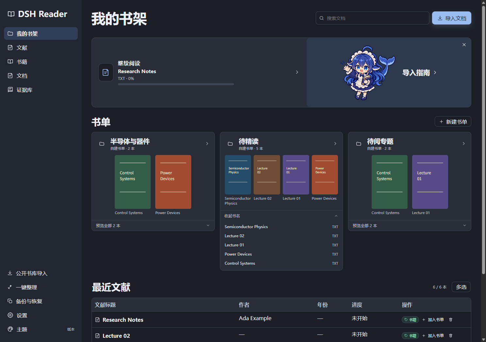 | 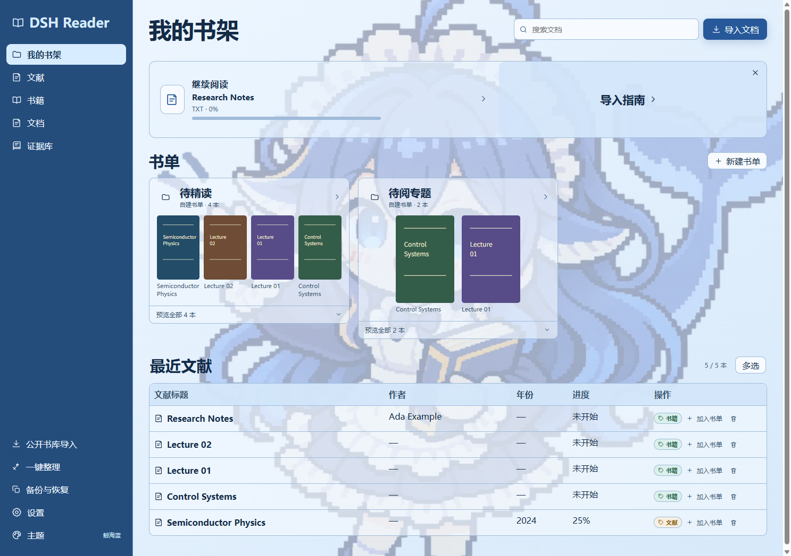 | 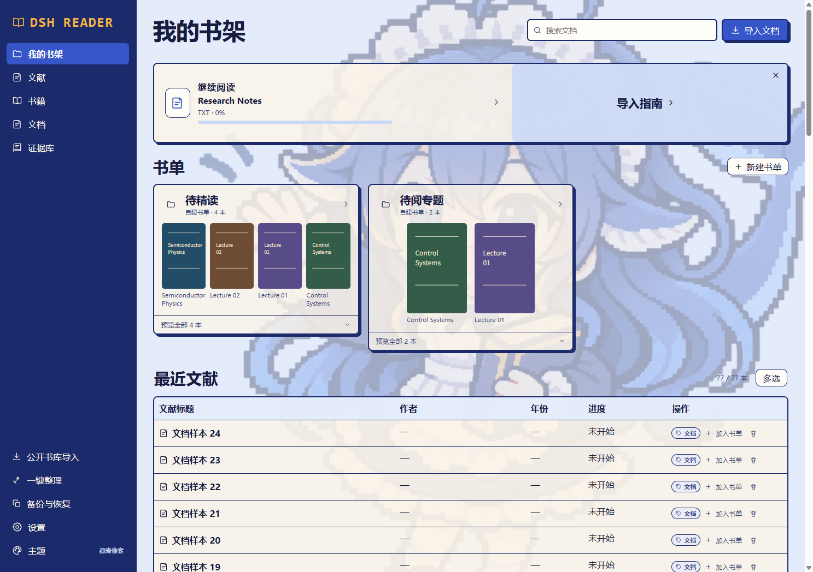 |
| Warme Papiertöne, das winkende Walmädchen sitzt auf der Begrüßungskarte. | Hellblaues Regal mit dem Walmädchen als halbtransparentem Hintergrund. | Marineblaue Seitenleiste, cremefarbene Karten und Pixelkonturen. |

Beide Walmädchen-Designs zeigen auf der Startseite sowie unter Fachliteratur, Büchern und Dokumenten jeweils ein passendes Motiv. Der Hintergrund bleibt beim Scrollen stehen.

Beim Lesen einer PDF steht links die Gliederung und in der Mitte das Original. Rechts wechselst du zwischen den Belegen und der Übersetzung des aktuellen Artikels.

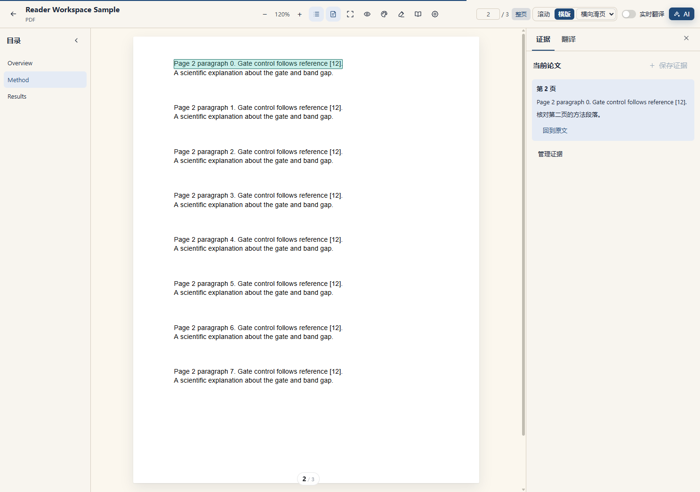

Die Bildschirmfotos zeigen synthetische Testdokumente. Die Oberfläche ist chinesisch.

## Funktionen

| Funktion | Möglichkeiten |
| --- | --- |
| Formate | PDF, EPUB, MOBI/AZW/AZW3, TXT, Markdown und HTML lesen. |
| Lokale Bibliothek | Standardkategorien und eigene Sammlungsordner mit Covervorschau, Suche und Zuordnung mehrerer Bücher auf einmal. |
| PDF-Anzeige | Scrollen oder horizontal umblättern, zoomen, Seitenbreite/ganze Seite anpassen, Seiten anspringen und Text auswählen. |
| PDF-Übersetzung | Feste chinesische Übersetzungsspalte mit Absatzverknüpfung, Glossar, Pause/Wiederholung und lokalem Cache. |
| E-Books | Typografie anpassen und in beide Richtungen über Kapitelgrenzen hinweg blättern. |
| Notizen und KI | Markierungen, Unterstreichungen, Notizzettel, Übersetzung einer Auswahl, Fragen im Kontext und Google/Google Scholar. |
| Darstellung | Schrift, Abstände, Textbreite, Helligkeit, Hintergrund und immersives Lesen anpassen. |
| Öffentliche Quellen | Unterstützte direkte Dateilinks aus öffentlichen Buchsammlungen und Open-Access-Quellen importieren. |
| Belege sichern | Text in einer PDF auswählen und als Beleg speichern, auf Wunsch mit bestätigter Übersetzung, und später aus der Belegsammlung zur genauen Stelle zurückkehren. |
| Themenvergleich und Export | Zu einer Sammlung eine Forschungsfrage festhalten, Belege aus mehreren Artikeln gruppieren, Vergleiche verfassen und als UTF-8-Markdown exportieren. |
| Sicherung und Wiederherstellung | Lese- und Forschungsdaten als lokale ZIP-Datei exportieren, wahlweise mit Originaldateien, und Konflikte vor der Wiederherstellung prüfen. |
| Bibliotheksdesigns | Papier, Walblau oder Marine-Pixel wählen, mit Vorschau vor dem Anwenden. |

Projektübersicht und Installationsanleitungen gibt es auf Englisch, Chinesisch und Deutsch. Die Oberfläche ist derzeit überwiegend chinesisch. Automatische Dokumentübersetzungen erscheinen auf **vereinfachtem Chinesisch**.

## Installation

Die [Installationsanleitung](docs/INSTALL.de.md) beschreibt Desktop, CLI/Web, lokale Entwicklung, Aktualisierungen und Fehlerbehebung. Die Build-Dateien für eine reguläre GitHub-Installation sind enthalten.

| Methode | Adresse oder Aktion |
| --- | --- |
| DSH-Pluginverwaltung — empfohlen | **Plugins → Add plugin** → `github:Popipot/DSH-Reading-Plugin#main` |
| Quellcode herunterladen | [Quellcode einschließlich Build-Dateien herunterladen](https://github.com/Popipot/DSH-Reading-Plugin/archive/refs/heads/main.zip) |
| CLI-verwaltetes Web-Profil | Folgenden Befehl ausführen und die betreffende Web-Instanz neu starten. |

```sh
dsh plugin --profile web add "github:Popipot/DSH-Reading-Plugin#main"
```

Für Desktop die integrierte Pluginverwaltung verwenden. Eine Installation im Profil `web` installiert das Plugin nicht im separaten Desktop-Profil.

## Schritt für Schritt

Das Walmädchen führt durch die Anleitung. Die Nummern in jedem Bildschirmfoto gehören zu den Schritten darunter, und das Schild zeigt die Position in der Abfolge. Die Bildschirmfotos zeigen Beispieldokumente im Design Marine-Pixel. Die Oberfläche ist chinesisch.


### Bibliothek: importieren und ordnen

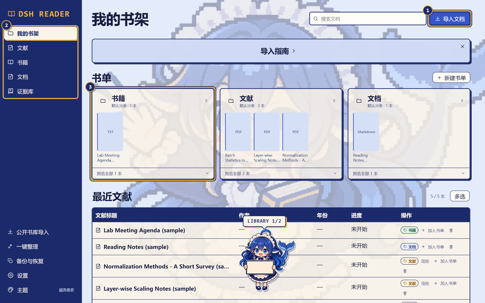

1. **导入文档** (Dokument importieren) wählen oder Dateien in die Bibliothek ziehen. Unterstützt werden PDF, EPUB, MOBI, TXT, Markdown und HTML.
2. In der Seitenleiste zwischen **我的书架** (Meine Bibliothek), **文献** (Fachliteratur), **书籍** (Bücher), **文档** (Dokumente) und **证据库** (Belege) wechseln.
3. Sammlungskarten zeigen eine Covervorschau. **预览全部** (Alle anzeigen) klappt die vollständige Titelliste auf. Mit **新建书单** (Neue Sammlung) nach Thema ordnen. Ein Buch kann in mehreren Sammlungen liegen und behält eine Leseposition und einen Satz Anmerkungen.

Für mehrere Bücher auf einmal zuerst **多选** (Mehrfachauswahl) wählen. Die [bebilderte chinesische Anleitung](docs/USER_GUIDE.zh-CN.md#图书馆封面书单与批量归类) zeigt, wie Sammlungen bearbeitet und Bücher entfernt werden.

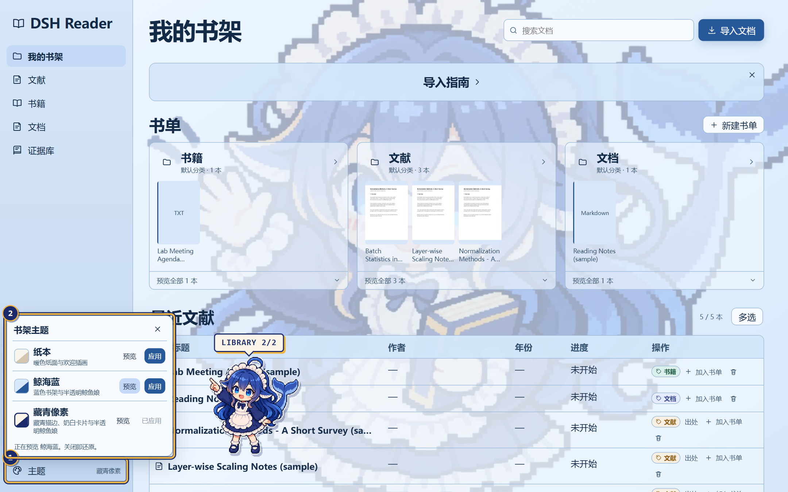

1. Unten in der Seitenleiste **主题** (Design) wählen.
2. Mit **预览** (Vorschau) ein Design ansehen und mit **应用** (Anwenden) übernehmen. Beim Schließen der Auswahl kehrt das bisherige Design zurück.

### PDF-Arbeitsbereich: vom Lesen zum gesicherten Beleg

**Schritt 1: PDF öffnen**

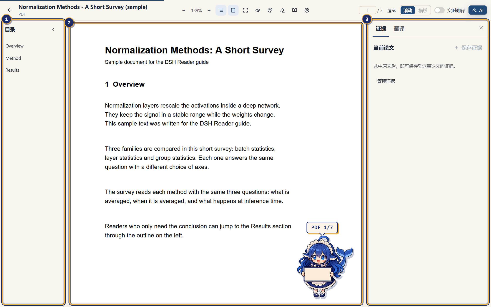

1. Links steht die Gliederung.
2. In der Mitte steht das Original im unveränderten Layout.
3. Rechts liegt die Lesespalte. Sie wechselt zwischen **证据** (Belege) und **翻译** (Übersetzung).

**Schritt 2: Zur gewünschten Stelle springen**

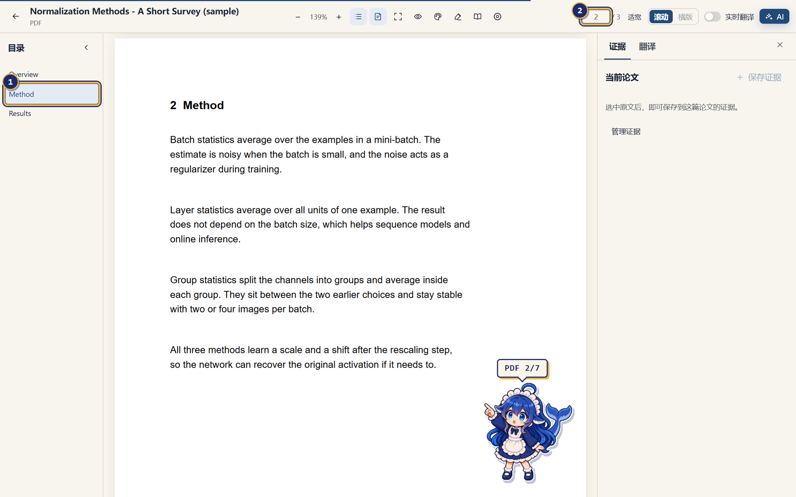

1. Einen Abschnitt in der Gliederung anklicken, um zu seiner Seite zu springen.
2. Oder eine Seitenzahl in das Seitenfeld eingeben und die Eingabetaste drücken. Das hilft bei PDFs ohne Gliederung.

**Schritt 3: Chinesische Übersetzung einschalten**

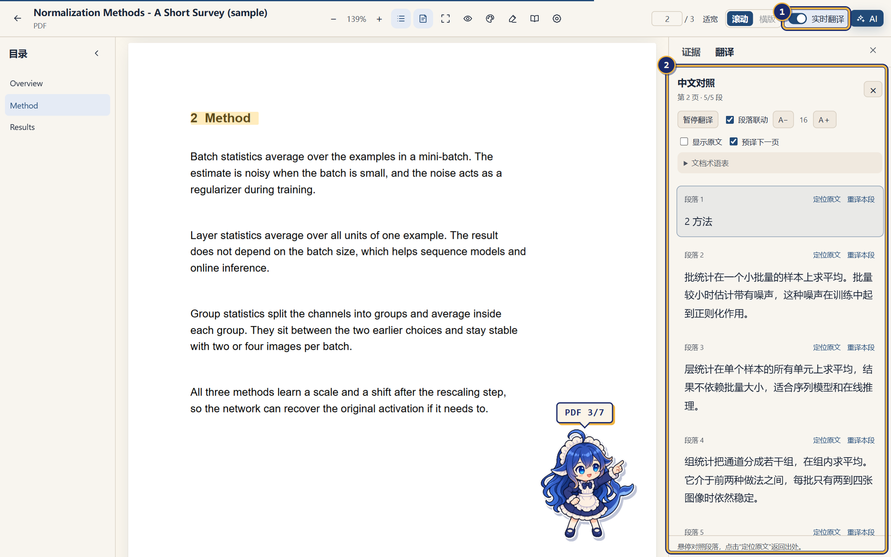

1. Oben **实时翻译** (Live-Übersetzung) einschalten. Sie ist standardmäßig aus und nutzt das in DSH eingerichtete Modell.
2. Die Spalte zeigt die Übersetzung absatzweise. **定位原文** (Original anzeigen) führt zum passenden Absatz, **重译本段** (Neu übersetzen) übersetzt ihn erneut. Hier lassen sich auch die Schriftgröße ändern, das Glossar bearbeiten und die nächste Seite vorübersetzen.

**Schritt 4: Die Stelle markieren, die zitiert werden soll**

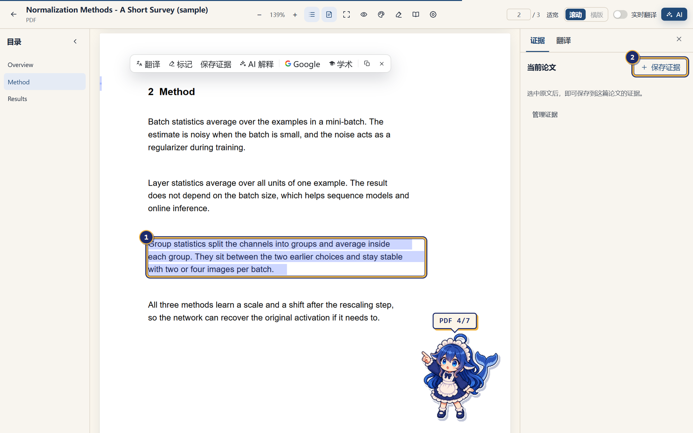

1. Text im Original markieren. Die schwebende Werkzeugleiste kann ihn übersetzen, hervorheben, von der KI erklären lassen oder danach suchen.
2. In der Spalte **保存证据** (Beleg speichern) wählen.

**Schritt 5: Beleg speichern**

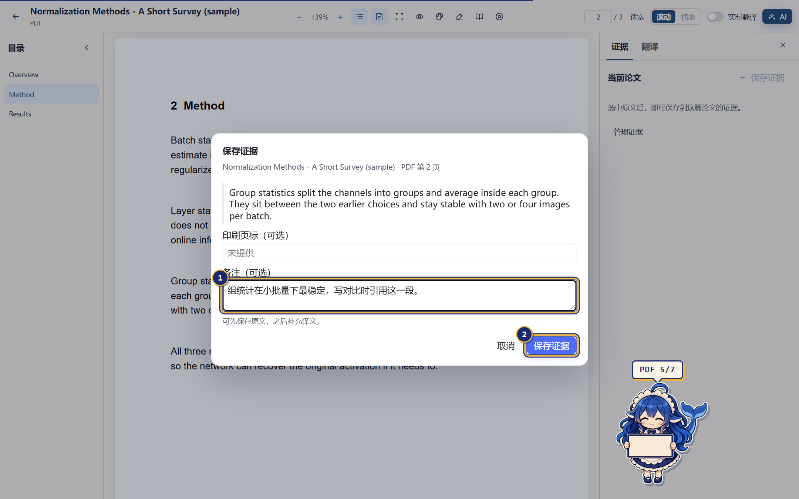

1. Notiz und gedruckte Seitenangabe sind freiwillig. Eine Übersetzung lässt sich später ergänzen.
2. **保存证据** (Beleg speichern) wählen.

**Schritt 6: Vom Beleg zum Original zurückkehren**

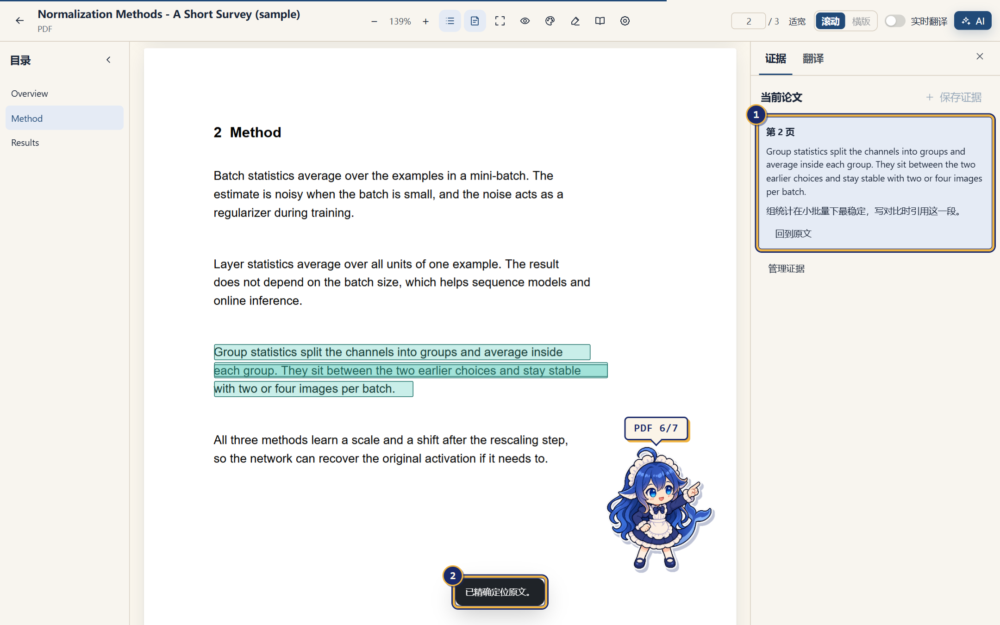

1. Die Belege des aktuellen Artikels stehen in der Spalte. **回到原文** (Zurück zum Original) wählen.
2. Die Ansicht springt zur gespeicherten Auswahl und meldet, ob die Stelle genau gefunden wurde.

**Schritt 7: Leseansicht anpassen**

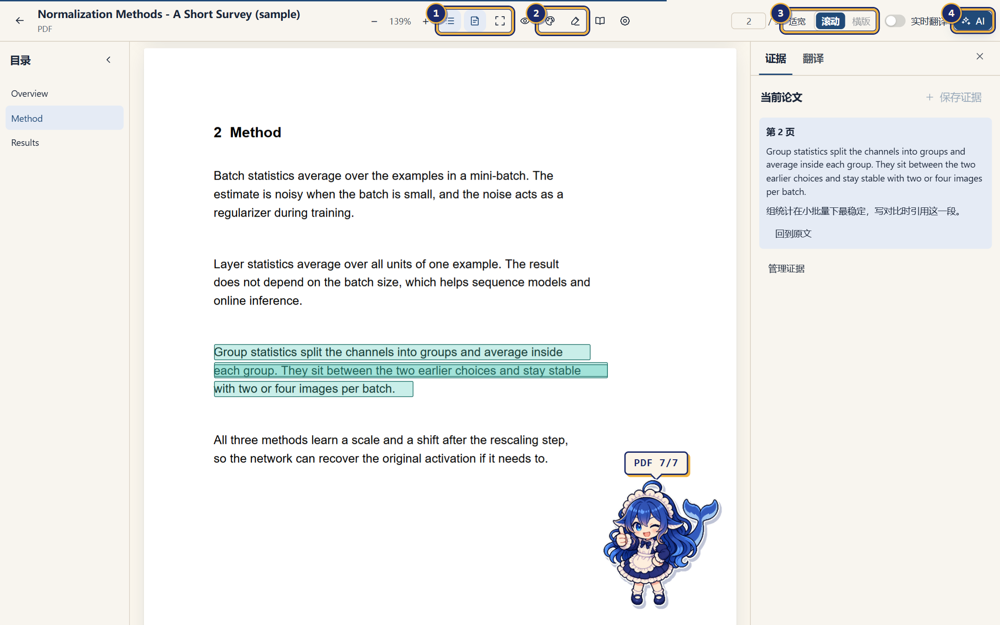

1. Schalter für Gliederung, Lesespalte und immersiven Modus.
2. Darstellung sowie Anmerkungen und Notizen.
3. **适宽** (Seitenbreite) wechselt den Zoom zwischen Seitenbreite und ganzer Seite. **滚动** (Scrollen) und **横版** (Horizontal) ändern das Blättern.
4. Die KI-Spalte öffnen und Fragen zum aktuellen Dokument stellen.

### Belegsammlung und Themen

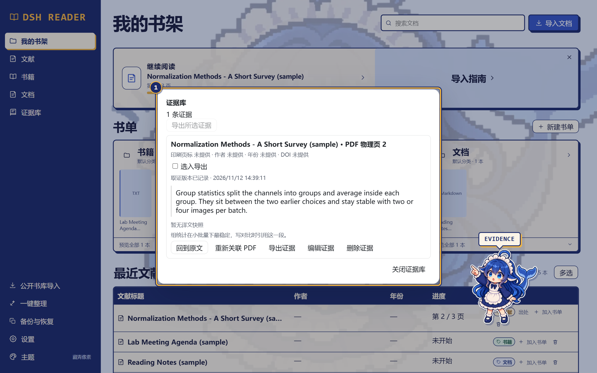

1. **证据库** (Belege) in der Seitenleiste sammelt die Belege aller Dokumente. Von dort geht es zurück zum Original, und Belege lassen sich bearbeiten, löschen oder für den Export auswählen.

Für eine Übersichtsarbeit in einer Sammlung eine Forschungsfrage festhalten, Belege aus mehreren Artikeln gruppieren, Synthesenotizen schreiben und als UTF-8-Markdown exportieren. **备份与恢复** (Sicherung und Wiederherstellung) in der Seitenleiste exportiert Lese- und Forschungsdaten als lokale ZIP-Datei und zeigt Konflikte vor der Wiederherstellung.

### Weitere Formate und Blättern

Die Übersetzungsspalte lässt sich unabhängig scrollen, während das PDF sein Originallayout behält. Sie bietet Absatzverknüpfungen, ein Glossar, eine einstellbare Schriftgröße, erneute Übersetzungsversuche und die optionale Vorübersetzung der nächsten Seite. Bei E-Books mit fließendem Layout stehen Übersetzungen unter den Absätzen.

Im horizontalen Modus beginnt jedes E-Book-Kapitel auf einer neuen Seite. Einmal vorwärts blättern führt vom Kapitelende auf die erste Seite des nächsten Kapitels. Einmal rückwärts blättern führt vom Kapitelanfang auf die letzte Seite des vorherigen Kapitels. Bei EPUB und anderen Formaten mit fließendem Layout kannst du zwischen horizontalem Schieben, Überdecken und einer 3D-Animation mit Faltung ab der Seitenecke wählen. Der Reader berücksichtigt die Systemeinstellung für reduzierte Bewegung. Die 3D-Animation verwendet die Faltgeometrie von [StPageFlip](https://github.com/Nodlik/StPageFlip) ([MIT-Hinweis](LICENSES/StPageFlip.txt)).

Die [bebilderte chinesische Anleitung](docs/USER_GUIDE.zh-CN.md) enthält auch Screenshots zur PDF-Ansicht und zu Anmerkungen.

## PDF-Leistung

Analyse und Zeichnen laufen, soweit unterstützt, in separaten Workern. Lokale Dateien werden bedarfsgerecht abschnittsweise gelesen; nahe Seiten werden virtualisiert. Vorschaubilder werden verfeinert, zuletzt gelesene Seiten in einem begrenzten Bildcache gehalten. Die Cover-Erstellung stoppt beim Öffnen des Readers.

Die Leistungstests umfassen komplexe Beispiel-PDFs und ein direkt in DSH geöffnetes Lehrbuch mit 1.029 Seiten. Das [Optimierungsprotokoll](OPTIMIZATION.md#12-pdf-性能方案-a双-worker随机读取与分级缓存2026-11-06) dokumentiert Testumgebung und Messergebnisse auf Chinesisch.

## Datenschutz und Grenzen

- Dokumente, Anmerkungen, Lesepositionen und Übersetzungscaches liegen lokal in IndexedDB/localStorage. Öffentliche Importe werden über den lokalen DSH-Host heruntergeladen.
- Übersetzung und KI senden relevante Textstellen, begrenzten Kontext und gegebenenfalls das Glossar an das in DSH konfigurierte Modell. Die Vorübersetzung sendet auch Text der nächsten Seite. Modellaufrufe können Kosten verursachen.
- Gescannte PDFs lassen sich anzeigen; Textauswahl und Übersetzung benötigen eine vorhandene Textebene. OCR ist nicht enthalten.
- DRM-E-Books werden nicht unterstützt; manche festen oder vertikalen Layouts werden als fließender Text dargestellt.
- Layoutgetreuer Export übersetzter PDFs und Export von Anmerkungen sind nicht enthalten. Belege und Themennotizen lassen sich als Markdown exportieren. Beim Löschen lokaler Website-Daten gehen Bibliothek und Einstellungen verloren.

## Entwicklungsstand

**Designkontrast.** Beim Überfahren, Fokussieren und Drücken behalten die Schaltflächen zum Anwenden ihre Designfarben. Bei Walblau setzt sich die kräftigere blaue Navigation vom sanfteren Bücherregal ab.

**9. November 2026 · B1 freigegeben · Alle 40 Prüfungen bestanden.** Im immersiven Modus bleiben beschriftete Schaltflächen für Darstellung, Vollbild und Beenden sichtbar. Bei E-Books lässt sich auch das Inhaltsverzeichnis ein- und ausblenden. Leiste und Einstellungsfenster übernehmen das Lesefarbschema. Die Einstellungen bleiben beim Neustart erhalten.

**B1-Update für die PDF-Werkzeugleiste.** Dokumenttitel, Zoom, Ganzseitenansicht und Seitennavigation sind jetzt in die farblich abgestimmte Leiste des immersiven Modus integriert. Bei 540 CSS-Pixeln bleiben die Bedienelemente in einer Zeile. In schmaleren Fenstern werden sie gruppenweise umgebrochen. Build `fed3d4f` hat die gezielten Prüfungen für PDF-Navigation, Darstellung und Tastaturbedienung nach der B1-Baseline bestanden.

**Reguläre PDF-Ansicht.** Eine gemeinsame Leiste zeigt links den Dokumenttitel, mittig die Symbolschaltflächen und rechts die beschrifteten Bedienelemente und das Seitenfeld. In schmalen Fenstern werden die Gruppen umgebrochen. Build `09fb67e` hat die gezielten B1-Prüfungen für PDF-Navigation, Darstellung und Tastaturbedienung bestanden.

**PDF-Zoomanzeige.** In der regulären PDF-Ansicht steht der Zoomwert jetzt zwischen Minus und Plus. Build `a4ad96f` hat die gezielten Desktop- und PDF-Browserprüfungen bestanden.

**Umblättern am Seitenrand.** Im Seitenmodus blättert ein Klick auf den freien linken oder rechten Rand zurück oder vor. Der Klickbereich passt sich der Lesefläche an und liegt außerhalb des Inhalts. E-Books behalten in schmalen Fenstern seitliche Ränder. Bei PDFs stehen Seitenfeld und Tastatur weiterhin zur Verfügung. Build `ed9970d` hat die gezielten Desktop-Prüfungen und den Umblättertest für sechs Formate bestanden.

**B2 zur Belegerfassung für einen Artikel ist freigegeben.** Eine Textauswahl auf einer PDF-Seite lässt sich als eigenständiger Beleg speichern, auf Wunsch mit bestätigter Übersetzung. Nach Prüfung der vollständigen PDF-Datei führt die Belegsammlung zur Auswahl zurück. Bei fehlender Quelldatei bleibt der Beleg lesbar und exportierbar. Revision `bce3e2b` bestand alle neun Prüfungen. Alle 20 Zielstellen wurden präzise gefunden. In zehn Ausnahmefällen gab es keine fälschlich als exakt gemeldete Fundstelle. Bei 20 Speichervorgängen in DSH Desktop lag das P95 bei 14,4 ms.

**B3 für Themenvergleich und Export ist freigegeben.** In einer Bücherliste lassen sich eine Forschungsfrage festhalten, Belege mehrerer Artikel gruppieren und nach Artikel filtern sowie Vergleiche verfassen. Quellenangaben und gedruckte Seitenbezeichnungen können ergänzt werden. Ausgewählte Belege und ganze Themen lassen sich als UTF-8-Markdown exportieren. Revision `93436e0` bestand alle sieben Prüfungen, darunter neun präzise PDF-Rücksprünge und neun vollständige Quellenangaben im Export. Bei 100 Artikeln und 1.000 Belegen lag das P95 für die Filterung bei 31,8 ms.

**PDF-Ansicht.** Bei angepasster Breite wird durchgehend gescrollt. In der Ganzseitenansicht stehen Scrollen und Blättern zur Wahl. Die Schaltfläche zeigt in beiden Werkzeugleisten die aktuelle Ansicht an.

**Lokale ZIP-Sicherung und Wiederherstellung.** In der Bibliothek oder in den Leseeinstellungen lassen sich Lese- und Forschungsdaten mit oder ohne Originaldateien exportieren. Vor der Wiederherstellung prüft die Bibliothek das Archiv und zeigt Konflikte bei gleichen IDs. B4-Kandidat e5f61dc bestand alle neun Prüfungen nach v0.1.

**Lesearbeitsplatz nach Entwurf A.** Die Bibliothek bietet eine Seitennavigation, Suche und Import im Kopfbereich, Sammlungen mit Buchcovern und eine Liste zuletzt genutzter Dokumente. Im PDF-Standardmodus steht das Inhaltsverzeichnis links. Rechts lassen sich Belege zum aktuellen Dokument und die Übersetzung aufrufen. In schmalen Fenstern bleibt die gesamte verfügbare Breite für das PDF erhalten.

**Bibliotheksthemen.** Öffnen Sie unten in der Seitenleiste **主题** (Design). Sehen Sie sich **纸本** (Papier), **鲸海蓝** (Walblau) oder **藏青像素** (Marine-Pixel) direkt in Ihrem Bücherregal an und speichern Sie Ihre Wahl mit **应用** (Anwenden) auf diesem Gerät. Walblau zeigt auf der Startseite sowie unter Fachliteratur, Büchern und Dokumenten jeweils ein eigenes halbtransparentes Walmädchen. Die vergrößerten Motive sind auf den Schwerpunkt der gesamten Figur zentriert und bleiben auch beim Scrollen im Vollbild an derselben Stelle. Marine-Pixel kombiniert eine marineblaue Seitenleiste mit cremefarbenen Karten und Pixelkonturen und zeigt dieselben vier Walmädchen-Hintergründe.

**Bedienelemente auf Bibliothekskarten.** Kategorien bleiben einzeilig. Bei wenig Platz wechseln ganze Schaltflächen in die nächste Zeile.

**Illustrationen in der Bibliothek.** Das winkende Pixel-Walmädchen steht auf der Startseite der Bibliothek im Mittelpunkt und passt seine Größe an das Fenster an. Das Pixel-Walmädchen liest bei Büchern, sucht mit der Lupe bei Fachliteratur und schreibt bei Dokumenten. Weitere Posen begrüßen beim Start und begleiten leere Sammlungen und erfolgreiches Hinzufügen. [Alle sechs Posen ansehen](images/whale-girl/README.md).

**B5-Nutzertest.** Die [festgelegte Vorabversion v0.1.0-b5.1](https://github.com/Popipot/DSH-Reading-Plugin/releases/tag/v0.1.0-b5.1) basiert auf dem B4-Commit 199a485. Die Unterlagen für den 14-tägigen Test mit 15 Personen liegen vor. Der Test steht noch aus.

**Werbevideo.** Ein kurzes Hochformatvideo, präsentiert vom Walmädchen, ist in Arbeit und soll Testpersonen gewinnen. Es zeigt die echte Oberfläche der aktuellen Version, die Sprecherstimme wird lokal erzeugt. Der fertige Schnitt folgt, sobald das Dialogskript freigegeben ist.

Im früheren B1-Leistungstest mit 80 kalten Dokumentöffnungen in DSH Desktop lag der höchste P95 je Testgruppe bei **1.375 ms** für den Referenzartikel und **2.426 ms** für das Lehrbuch mit 1.029 Seiten. Bei 480 Seitenwechseln in DSH Web lag der höchste P95 bei **44 ms** mit und **259 ms** ohne Vorladen. Der finale Build bestand die Desktop-Prüfung der Darstellung und sechs Browser-Regressionsreihen.

## Feedback

**Verbesserungsvorschläge und Berichte auf Deutsch, Englisch oder Chinesisch sind willkommen.**

| Anliegen | Anlaufstelle |
| --- | --- |
| Langsames Öffnen, Ruckeln, Speicherverbrauch oder PDF-Darstellung | [Leistung & Optimierung](https://github.com/Popipot/DSH-Reading-Plugin/issues/new?template=performance.yml) |
| Reproduzierbare Fehler, leere Seiten oder Probleme beim Umblättern | [Fehler melden](https://github.com/Popipot/DSH-Reading-Plugin/issues/new?template=bug_report.yml) |
| Neue Funktionen, Leseabläufe oder bessere Bedienbarkeit | [Funktion vorschlagen](https://github.com/Popipot/DSH-Reading-Plugin/issues/new?template=feature_request.yml) |
| Vorhandene Berichte und Diskussionen | [Issues ansehen](https://github.com/Popipot/DSH-Reading-Plugin/issues) |

Bitte DSH-/Plugin-Versionen, Betriebssystem, Reproduktionsschritte sowie erwartetes und tatsächliches Verhalten angeben. Bei Leistungsproblemen zusätzlich Dateigröße, Seitenzahl, Lesemodus und Verhalten ohne Übersetzung nennen. Kleine öffentliche oder anonymisierte Beispiele statt privater Dokumente verwenden.

Hinweise zu Beiträgen und Prüfungen: [CONTRIBUTING.md](CONTRIBUTING.md) (Englisch).

## Entwicklung

Node.js-Anforderung laut [package.json](package.json): `^22.19.0 || >=24.0.0`.

```sh
git clone https://github.com/Popipot/DSH-Reading-Plugin.git
cd DSH-Reading-Plugin
npm ci
npm run build
npm test
npm run test:pdf-browser
npm run test:flow-browser
npm run test:library-browser
npm run test:flow-animations
npm run test:translation-browser
npm run test:pdf-performance -- --hidpi
```

Browserprüfungen verwenden ein separates Chrome-Profil; bei Bedarf `CHROME_PATH` setzen. Übersetzungstests verwenden einen lokalen simulierten Dienst. Berichte liegen unter `output/playwright/` und werden nicht eingecheckt. `npm run test:pdf-performance -- "/pfad/zum/dokument.pdf"` unterstützt beliebige Seitenzahlen; der separate Standardtest für PDF-Navigation erwartet beim Ersetzen seiner Beispieldatei mindestens 1.029 Seiten.

Quellcode: `web/src/` (Reader/Parser), `lib/` (Host-Routen), `scripts/` und `tests/` (Build/Tests). Fertige Dateien: `client/client.js` und `dist/reader-assets/`. Schnittstellen: [CONTRACTS.md](CONTRACTS.md).

## Mitwirkende

- [Popipot](https://github.com/Popipot) betreut das Projekt.
- [Codex](https://github.com/codex) unterstützte als KI-Programmierassistent bei der Implementierung, Fehlersuche, Prüfung und Dokumentation.

## Kontakt

**E-Mail: [csty341@gmail.com](mailto:csty341@gmail.com)**

Für öffentliche Fehlerberichte und Ideen bitte GitHub Issues nutzen, damit andere die Diskussion verfolgen können. Direkter Kontakt ist auch per E-Mail möglich.

## Lizenz

[MIT](LICENSE). Enthaltene Ressourcen Dritter behalten ihre eigenen Lizenzhinweise.
