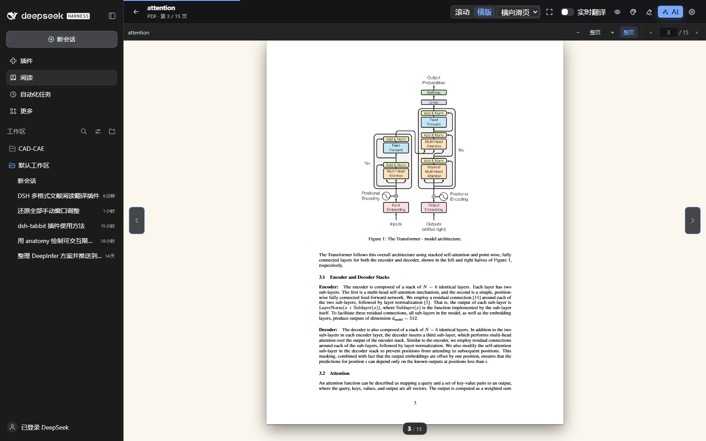

# DSH Reader

**English** · [简体中文](README.zh-CN.md) · [Deutsch](README.de.md)

**[Install & tutorial](docs/INSTALL.en.md)** · **[Download ZIP](https://github.com/Popipot/DSH-Reading-Plugin/archive/refs/heads/main.zip)** · **[Suggest an improvement](https://github.com/Popipot/DSH-Reading-Plugin/issues/new?template=feature_request.yml)** · **[Report slowness](https://github.com/Popipot/DSH-Reading-Plugin/issues/new?template=performance.yml)**

A reading workspace inside **DeepSeek Harness** for papers and books: a local library, PDF/ebook reading, Chinese translation, annotations, and contextual AI assistance.

> **Quick install:** Open **DSH → Plugins → Add plugin**, paste the address below, install, then enable **dsh-reader**. Fully restart DSH if requested. Open **阅读** (Reading) in the sidebar.
>
> `github:Popipot/DSH-Reading-Plugin#main`
>
> [Step-by-step installation](docs/INSTALL.en.md) · [Get DeepSeek Harness](https://www.deepseek.com/harness/en/) · [Bugs & feedback](https://github.com/Popipot/DSH-Reading-Plugin/issues/new/choose) · [csty341@gmail.com](mailto:csty341@gmail.com)


## Features

| Feature | What you can do |
| --- | --- |
| Formats | Read PDF, EPUB, MOBI/AZW/AZW3, TXT, Markdown, and HTML. |
| Local library | Search, categorize books/papers/documents, display covers, and resume reading. |
| PDF reading | Scroll or turn pages horizontally; zoom, fit width/whole page, jump to a page, and select text. |
| PDF translation | Keep the original beside a fixed Chinese translation pane with paragraph linking, glossary, pause/retry, and local caching. |
| Ebooks | Use chapter navigation, adjustable typography, horizontal pagination, and page animations. |
| Notes and AI | Highlight, underline, add sticky notes, translate a selection, ask contextual questions, or search Google/Google Scholar. |
| Appearance | Adjust fonts, spacing, width, brightness, backgrounds, and immersive reading. |
| Public-source import | Import supported direct file links from public book and open-access sources. |

**Language scope:** These project pages and installation guides are available in English, Chinese, and German. The reader interface is currently primarily Chinese; automatic document translation targets **Simplified Chinese**. German/English interface localization and selectable translation targets are not implemented yet.

## Install

The [installation tutorial](docs/INSTALL.en.md) covers Desktop, CLI/Web, local development, updates, and troubleshooting. Build assets are included for a normal GitHub installation.

| Method | Address or action |
| --- | --- |
| DSH plugin manager — recommended | **Plugins → Add plugin** → `github:Popipot/DSH-Reading-Plugin#main` |
| Source download | [Download source and included build assets](https://github.com/Popipot/DSH-Reading-Plugin/archive/refs/heads/main.zip) |
| CLI-managed Web profile | Run the command below, then restart that Web instance. |

```sh
dsh plugin --profile web add "github:Popipot/DSH-Reading-Plugin#main"
```

For Desktop, use its plugin manager. A `web` profile installation does not install into Desktop's separate profile.

## Start reading

1. Open **阅读** (Reading) in the DSH sidebar.
2. Drop a supported file into the library or choose **导入文档** (Import document).
3. Open it and choose scrolling or horizontal page turning in the top bar.
4. Enable **实时翻译** (Live translation) when needed. It is off by default.
5. Select text to translate, annotate, ask AI, or search. Progress and notes are saved locally.

For PDFs, the translation pane scrolls independently and does not change the original page layout. It supports paragraph links, glossary, font size, retry, and optional next-page pretranslation. Reflowable ebooks show translations below paragraphs.



More illustrated instructions: [Chinese user guide](docs/USER_GUIDE.zh-CN.md).

## PDF performance

Parsing and drawing use separate workers where supported. Local files use on-demand range reads; nearby pages are virtualized. Preview images refine to full quality, recently viewed pages use a bounded image cache, and background cover generation stops when you enter the reader.

The current implementation passed **185 tests**, PDF/translation/five-format pagination browser checks, and complex-document performance checks. The existing 1,029-page Floyd textbook was also checked inside DSH. Results depend on file, hardware, and host; these checks are not an Adobe comparison or a guarantee of zero latency for every PDF.

Implementation history and measurement limits: [OPTIMIZATION.md, section 12](OPTIMIZATION.md#12-pdf-性能方案-a双-worker随机读取与分级缓存2026-11-06) (Chinese).

## Privacy and limitations

- Documents, notes, reading positions, and translation caches stay in local IndexedDB/localStorage. Public-source imports download through the local DSH Host.
- Translation and AI send relevant text, limited context, and applicable glossary to DSH's configured model. Optional pretranslation sends next-page text too. Model usage may incur charges.
- Scanned PDFs can be displayed; selection and translation require an existing text layer. OCR is not included.
- DRM ebooks and some complex fixed/vertical layouts are unsupported or fall back to reflowed reading.
- Layout-preserving translated PDF export and annotation export are not included. Clearing local site data removes the local library and settings.

## Feedback

**Help improve DSH Reader. Reports and suggestions in English, Chinese, or German are welcome.**

| What you want to share | Where to send it |
| --- | --- |
| Slow opening, stuttering, memory use, or rendering performance | [Performance & optimization feedback](https://github.com/Popipot/DSH-Reading-Plugin/issues/new?template=performance.yml) |
| Reproducible errors, blank pages, or page-turning problems | [Bug report](https://github.com/Popipot/DSH-Reading-Plugin/issues/new?template=bug_report.yml) |
| Features, reading workflows, or usability suggestions | [Feature request](https://github.com/Popipot/DSH-Reading-Plugin/issues/new?template=feature_request.yml) |
| Existing reports and discussions | [Browse issues](https://github.com/Popipot/DSH-Reading-Plugin/issues) |

Include DSH/plugin versions, OS, reproduction steps, and expected/actual behavior. For performance reports, add file size, page count, reading mode, and behavior with translation disabled. Use a small public or redacted sample instead of a private document.

See [CONTRIBUTING.md](CONTRIBUTING.md) for contribution and validation guidance.

## Development

Node.js requirement: `^22.19.0 || >=24.0.0`, as declared in [package.json](package.json).

```sh
git clone https://github.com/Popipot/DSH-Reading-Plugin.git
cd DSH-Reading-Plugin
npm ci
npm run build
npm test
npm run test:pdf-browser
npm run test:flow-browser
npm run test:translation-browser
npm run test:pdf-performance -- --hidpi
```

Browser checks use an isolated local Chrome profile; set `CHROME_PATH` if needed. Translation checks use a simulated local service. Reports go to `output/playwright/` and are not committed. `npm run test:pdf-performance -- "/path/to/document.pdf"` accepts any page count; the separate default PDF navigation regression expects at least 1,029 pages when replacing its fixture.

Source: `web/src/` (reader/parsers), `lib/` (Host routes), `scripts/` and `tests/` (build/checks). Included builds: `client/client.js` and `dist/reader-assets/`. Interface contracts: [CONTRACTS.md](CONTRACTS.md).

## Contact

**Email: [csty341@gmail.com](mailto:csty341@gmail.com)**

Use GitHub Issues for public reports and ideas so others can follow the discussion. Email is also available for direct contact.

## License

[MIT](LICENSE). Included third-party assets retain their own license notices.
