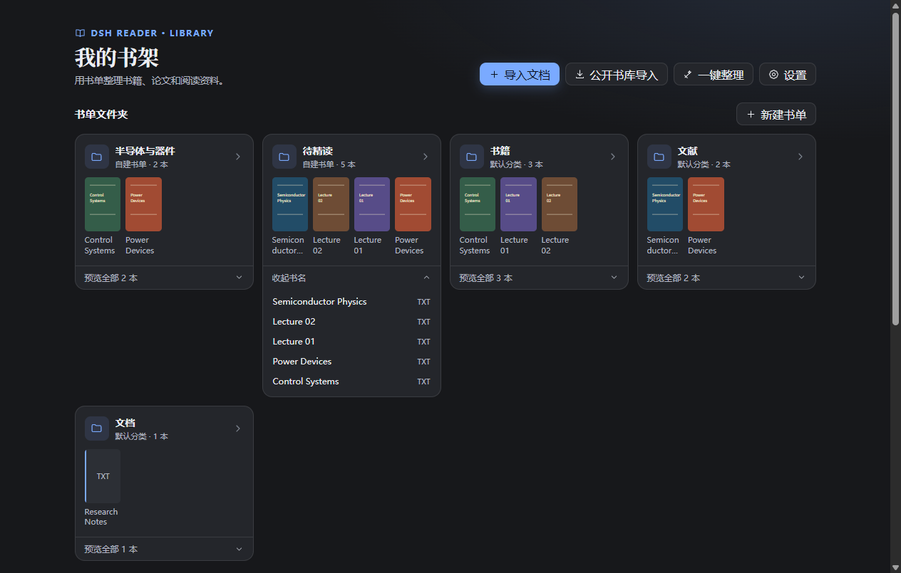

# DSH Reader

[English](README.md) · **简体中文** · [Deutsch](README.de.md)

**[安装与教程](docs/INSTALL.zh-CN.md)** · **[下载 ZIP](https://github.com/Popipot/DSH-Reading-Plugin/archive/refs/heads/main.zip)** · **[提出改进建议](https://github.com/Popipot/DSH-Reading-Plugin/issues/new?template=feature_request.yml)** · **[反馈卡顿与性能问题](https://github.com/Popipot/DSH-Reading-Plugin/issues/new?template=performance.yml)**

在 **DeepSeek Harness** 里读论文和书。用自建书单整理本地藏书，读 PDF 时对照中文译文，还能划词批注或就原文向 AI 提问。

> 打开 **DSH → 插件 → 添加插件**，粘贴下方地址。安装后启用 **dsh-reader**，从侧栏打开 **阅读**。如有提示，完整退出并重启 DSH。
>
> `github:Popipot/DSH-Reading-Plugin#main`
>
> [分步安装教程](docs/INSTALL.zh-CN.md) · [下载 DeepSeek Harness](https://www.deepseek.com/harness/) · [故障与建议入口](https://github.com/Popipot/DSH-Reading-Plugin/issues/new/choose) · [csty341@gmail.com](mailto:csty341@gmail.com)


## 开发进度

**2026 年 11 月 9 日 · B1 已放行 · 40 项全部通过。** 沉浸阅读顶部常驻外观、全屏和退出，电子书另有目录开关。按钮都有文字标签，工具栏和外观面板随阅读背景变化，设置重启后保留。

**B1 PDF 工具栏更新。** PDF 标题、缩放、整页显示和页码导航已并入顶部沉浸工具栏，配色随阅读主题变化。540 CSS px 宽时可排成一行，更窄时控件按组换行。构建 `fed3d4f` 按 B1 原基线通过 PDF 导航、外观及键盘专项复验。

**PDF 普通阅读。** 顶栏统一为左侧文档名、中间纯图标操作、右侧带文字的控件与页码输入。窄窗按组换行。构建 `09fb67e` 按 B1 原基线通过 PDF 导航、外观及键盘专项复验。

**PDF 缩放显示。** 普通阅读的缩放百分比已移到减号和加号之间。构建 `a4ad96f` 通过桌面专项和 PDF 浏览器回归。

**横版页边翻页。** 点击左侧留白后退，点击右侧留白前进。热区随正文视口变化，位于正文和 PDF 纸面之外。电子书窄窗保留两侧留白，PDF 仍支持页码输入和键盘翻页。构建 `ed9970d` 通过桌面专项和六格式翻页回归。

**B2 单篇取证已放行。** 在 PDF 单页内选中文字即可保存独立证据，可附上已确认的译文。证据库核验完整文件版本后可回到原选区。原文缺失时仍可查看和导出证据。候选 `bce3e2b` 通过全部 9 项基线验收，20 条选区精确回跳，10 个异常场景中精确定位误报为 0。DSH Desktop 20 次保存的 P95 为 14.4 ms。

**B3 专题比较与导出已放行。** 打开书单后进入「专题与证据」，可填写研究问题、分组比较多篇论文、按论文筛选并撰写综合笔记。论文出处可核对或补录，印刷页标与 PDF 物理页码分别记录。支持将所选证据或整专题导出为 UTF-8 Markdown。候选 `93436e0` 通过全部 7 项验收，9 条证据精确回跳，9 条导出出处完整。在 100 篇文献、1,000 条证据的规模下，筛选 P95 为 31.8 ms。

B1 前一轮性能测试在 DSH 桌面端完成 80 次冷打开，参考论文和 1029 页教材的最高分组 P95 分别为 **1375 ms** 和 **2426 ms**。DSH Web 完成 480 次相邻翻页，预热与未预热最高分组 P95 分别为 **44 ms** 和 **259 ms**。最终版本通过桌面外观复验及六类浏览器回归。

## 功能

| 功能 | 说明 |
| --- | --- |
| 多格式 | PDF、EPUB、MOBI/AZW/AZW3、TXT、Markdown、HTML。 |
| 本地书架 | 默认分类、自建书单文件夹、封面与完整书名预览、批量归类、搜索和继续阅读。 |
| PDF 阅读 | 滚动或横版翻页、缩放、适宽/整页、跳页与原生选字。 |
| PDF 对照翻译 | 固定中文侧栏、段落联动、术语表、暂停/重试与本地译文缓存。 |
| 电子书 | 可调排版，横版支持前后跨章翻页。 |
| 批注与 AI | 荧光笔、下划线、便签、划词翻译、上下文问答和 Google/Google 学术搜索。 |
| 阅读外观 | 字体、行距、版心宽度、亮度、背景与沉浸阅读。 |
| 公开来源导入 | 从公开书库与开放获取来源导入受支持的文件直链。 |

仓库主页和安装教程提供中英德三语。阅读界面目前主要为中文，文档自动翻译目标为**简体中文**。

## 安装

[完整安装教程](docs/INSTALL.zh-CN.md) 包含桌面版、CLI/Web、本地开发、更新和常见问题。仓库已包含正常 GitHub 安装所需的构建产物。

| 方式 | 地址或操作 |
| --- | --- |
| DSH 插件管理器（推荐） | **插件 → 添加插件** → `github:Popipot/DSH-Reading-Plugin#main` |
| 下载源码 | [下载源码及已构建资源](https://github.com/Popipot/DSH-Reading-Plugin/archive/refs/heads/main.zip) |
| CLI 管理的 Web profile | 执行下方命令，然后重启对应 Web 实例。 |

```sh
dsh plugin --profile web add "github:Popipot/DSH-Reading-Plugin#main"
```

桌面版请使用自带插件管理器。安装到 `web` profile 不会自动安装到桌面版独立的 profile。

## 整理书架

除了默认的「书籍」「文献」「文档」分类，还可以按专题、项目或阅读计划新建书单文件夹。每张卡片最多预览四本书的封面和书名。展开「预览全部」可查看完整书名清单，点书名直接阅读。



点击书籍卡片上的 **加入书单**，也可以先点 **多选** 批量归类。同一本书可以加入多个书单，阅读进度和批注共用。编辑书单或移出书籍的方法见 [书单图文教程](docs/USER_GUIDE.zh-CN.md#图书馆封面书单与批量归类)。

## 开始阅读

1. 在 DSH 侧栏打开 **阅读**。
2. 拖入支持的文件，或点击 **导入文档**。
3. 打开文档，在顶部切换滚动或横版阅读。
4. 需要时开启 **实时翻译**，默认关闭。
5. 选中文字即可翻译、标记、问 AI 或搜索；进度和批注保存在本机。

PDF 译文侧栏独立滚动，原文保持原有版式。侧栏支持段落联动、术语表、字号调整、重试和可选的下一页预译。EPUB 等流式格式的译文显示在段落下方。

横版阅读时，每章从新的一页开始。章末向前翻一次就到下一章第一页，从章首往回翻则到上一章最后一页。EPUB 等流式格式可选横向滑页、书页覆盖和从页角折起的 3D 书页。动画遵循系统的减少动态效果设置。3D 书页使用 [StPageFlip](https://github.com/Nodlik/StPageFlip) 的折页几何（[MIT 声明](LICENSES/StPageFlip.txt)）。

PDF 阅读和批注截图见 [中文使用详解](docs/USER_GUIDE.zh-CN.md)。

## PDF 性能

在支持的环境中，解析和绘制使用独立线程。本地文件按需分段读取，附近页面采用虚拟布局；预览逐步补清晰，最近阅读页使用有预算的图像缓存。进入阅读后停止后台封面生成。

性能检查涵盖复杂 PDF 样本，以及在 DSH 中实际打开的 1029 页教材。测试环境和实测数据见 [优化记录第 12 节](OPTIMIZATION.md#12-pdf-性能方案-a双-worker随机读取与分级缓存2026-11-06)。

## 隐私与限制

- 文档、批注、进度和译文缓存保存在本机 IndexedDB/localStorage。公开来源导入通过本地 DSH Host 下载。
- 翻译与 AI 将相关文字、有限上下文和适用的术语表发送给 DSH 当前模型；预译会发送下一页文字，模型调用可能计费。
- 扫描 PDF 可以显示；选字和翻译需要已有文本层，当前没有 OCR。
- 不支持 DRM 电子书；部分复杂固定版式/竖排电子书会降级为流式阅读。
- 暂无保留排版的译文 PDF 导出及批注导出。清空站点数据会移除本地书架和设置。

## 反馈与建议

**欢迎用中文、英语或德语提出优化意见，一起改进 DSH Reader。**

| 想反馈什么 | 提交入口 |
| --- | --- |
| 打开慢、卡顿、内存占用、PDF 渲染性能 | [性能与优化反馈](https://github.com/Popipot/DSH-Reading-Plugin/issues/new?template=performance.yml) |
| 空白页、翻页异常或可复现故障 | [提交故障报告](https://github.com/Popipot/DSH-Reading-Plugin/issues/new?template=bug_report.yml) |
| 新功能、阅读流程或易用性建议 | [提出功能建议](https://github.com/Popipot/DSH-Reading-Plugin/issues/new?template=feature_request.yml) |
| 已有报告和讨论 | [浏览 Issues](https://github.com/Popipot/DSH-Reading-Plugin/issues) |

请说明 DSH/插件版本、操作系统、复现步骤和期望/实际表现。性能反馈请补充文件大小、页数、阅读模式，以及关闭翻译后是否仍卡顿。请使用小型公开或脱敏样本，不要提交私密文档。

贡献流程与验证说明见 [CONTRIBUTING.md](CONTRIBUTING.md)（英语）。

## 开发

Node.js 要求见 [package.json](package.json)：`^22.19.0 || >=24.0.0`。

```sh
git clone https://github.com/Popipot/DSH-Reading-Plugin.git
cd DSH-Reading-Plugin
npm ci
npm run build
npm test
npm run test:pdf-browser
npm run test:flow-browser
npm run test:library-browser
npm run test:flow-animations
npm run test:translation-browser
npm run test:pdf-performance -- --hidpi
```

浏览器检查使用独立 Chrome 配置，可通过 `CHROME_PATH` 指定可执行文件；翻译回归使用本地模拟服务。报告位于 `output/playwright/`，不提交仓库。`npm run test:pdf-performance -- "真实文件.pdf"` 不限页数；另一个默认 PDF 导航回归替换样本时要求至少 1029 页。

源码：`web/src/`（阅读器/解析）、`lib/`（Host 路由）、`scripts/` 和 `tests/`（构建/测试）。构建产物：`client/client.js` 和 `dist/reader-assets/`。接口约定：[CONTRACTS.md](CONTRACTS.md)。

## 联系

**联系邮箱：[csty341@gmail.com](mailto:csty341@gmail.com)**

公开故障和优化意见建议提交 GitHub Issues，方便大家跟进；也可通过邮箱直接联系。

## 许可证

[MIT](LICENSE)。内置第三方资源保留各自的许可证声明。
