# DSH Reader 使用详解（中文）

[English overview](../README.md) · [中文主页](../README.zh-CN.md) · [Deutsch](../README.de.md) · [安装教程](INSTALL.zh-CN.md)

以下截图展示现有中文阅读界面。PDF 译文使用固定侧栏，EPUB 等流式格式使用段落下方译文。

一个装进 **DeepSeek Harness 左侧栏** 的中外文献/书籍阅读器。把 PDF、EPUB、MOBI、TXT 拖进来自动整理成书籍与文献书单；读到外文时译文实时出现；选中文字就能做荧光笔、下划线、便签和备注，也可以直接问 AI 或跳转 Google / Google 学术。

> 不是 PDF 阅读器的套壳：智能书架、排版外观、双语对照、批注笔记、选中问答都在同一个 DSH 面板里，文件与笔记默认只留在本机。
>
> PDF 大文件性能优化的完整过程、根因和验证基准见 [OPTIMIZATION.md](../OPTIMIZATION.md)。

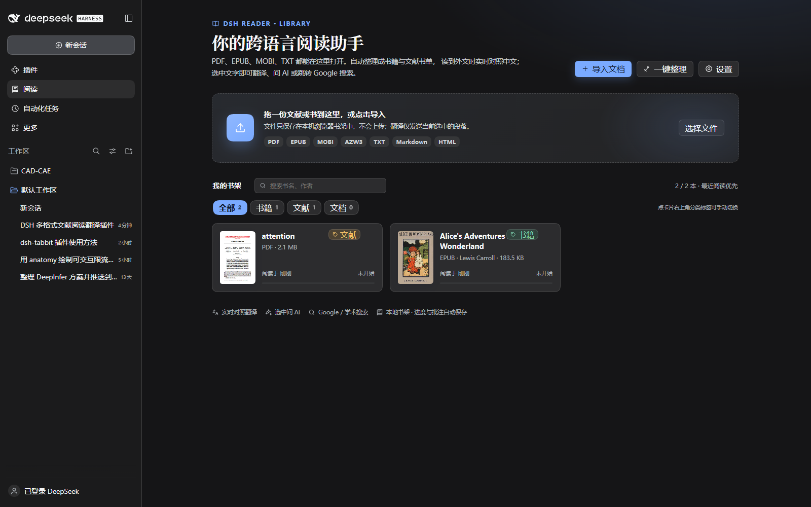

## 功能

| 能力 | 说明 |
| --- | --- |
| 左侧栏「阅读」入口 | 点击 DSH 侧栏的「阅读」图标即可打开，不打断当前对话 |
| 多格式 | PDF、EPUB、MOBI/AZW/AZW3、TXT、Markdown、HTML |
| 智能书架 | 书籍 / 文献 / 文档分类，搜索，一键按类型整理书单；卡片分类标签可手动切换 |
| 封面书墙 | EPUB/MOBI 显示原封面，PDF 自动生成第一页缩略图；无封面时显示格式书脊 |
| PDF 阅读 | PDF.js 连续页、懒渲染、可选中文字层、缩放/翻页、页码跳转；顶部「适宽 / 整页」一键切换单页完整显示 |
| 横版 PDF | 横版翻页时 PDF 自动单页独占屏幕，按真实页左右翻动并带水平动画 |
| 继续阅读 | 切换窗口或重新打开插件后自动回到上次的书与阅读位置；超大文档冷启动时先显示书架与「继续上次阅读」卡片，避免打开插件时被数百 MB 文件卡住 |
| EPUB / MOBI | 目录、章节、图片、内链、阅读进度；目录宽度可拖动调整，长标题完整换行 |
| 公开书库导入 | 从 Project Gutenberg / Standard Ebooks / arXiv / Open Library / Internet Archive 等公开来源粘贴文件直链，下载后自动打开 |
| 翻书方式 | 顶部任务栏直接切换连续滚动 / 横版翻页；滚轮、方向键、PageUp/PageDown、空格、左右按钮都能控制 |
| 横版分页 | 按真实行盒分页，每页从完整行开始，上下留出纸张边距；字号/行高/宽度变化后自动重排，末页自动均衡 |
| 章节翻页 | 翻页模式到达章末后，快速连按两次翻页键即进入下一章 |
| 翻页动画 | 横向滑页 / 书页覆盖 / 3D 书页，选择器就在顶部任务栏 |
| 沉浸模式 | 先在当前窗口沉浸，隐藏工具栏并收起目录；可再点按钮进入全屏，全屏后仍保持沉浸；目录图标会按背景主色自动取对比色 |
| 阅读排版 | 字体、字重、字号、行高、版心宽度（最大 1600px）、目录宽度、阅读亮度、背景预设/自定义颜色、背景图片与透明度/模糊 |
| 实时对照翻译 | 默认关闭，顶部一键开启；PDF 使用译文侧栏，流式格式在段落下方显示译文；支持隐藏译文与选中翻译 |
| 批注 | 宽荧光笔（三档粗细、四种颜色）、手绘感下划线、便签、选中文字写备注；PDF 同样支持 |
| 批注面板 | 按章节/页分组回看，定位跳转、编辑、删除，标注数量角标 |
| 选中工具栏 | 翻译、标记、AI 解释、Google、Google 学术、复制 |
| AI 阅读助手 | 使用 DSH 当前默认模型，解释术语/语法/论证；支持连续追问，流式回答 |
| 本地书架 | IndexedDB 保存文档、批注、背景图；自动记录页码/章节/滚动进度，不上传文件 |

### 图书馆：封面书墙与自动整理书单


导入后按类型自动归类：PDF 默认文献、EPUB/MOBI/TXT 默认书籍、Markdown/HTML 默认文档；PDF 标题/体积带书籍特征时会归为书籍。点「一键整理」重新按类型整理，点卡片右上角分类标签可手动在书籍/文献/文档之间切换。有封面的书会直接展示封面（PDF 自动渲染首页作为缩略图），方便视觉上快速锁定。

### 从公开书库直接导入

首页的「公开书库导入」支持粘贴公版书 / 开放获取论文的文件直链，由本机 Host 代下载、存入书架并自动打开。内置入口包括 Project Gutenberg、Standard Ebooks、arXiv、Open Library、Internet Archive、Wikisource。

> 为尊重版权，仅支持公开版权与开放获取来源的直链；不内置 Z-Library、Library Genesis 等版权不明的书源，也不会抓取登录后的私密页面。

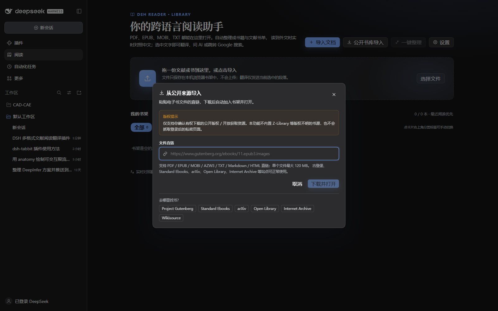

### 目录与版心都可调

目录右边缘可拖动加宽，长章节标题会完整换行而不是省略；外观面板里也能精确设置目录宽度。阅读宽度上限提高到 **1600px**，适合大屏或双栏阅读。

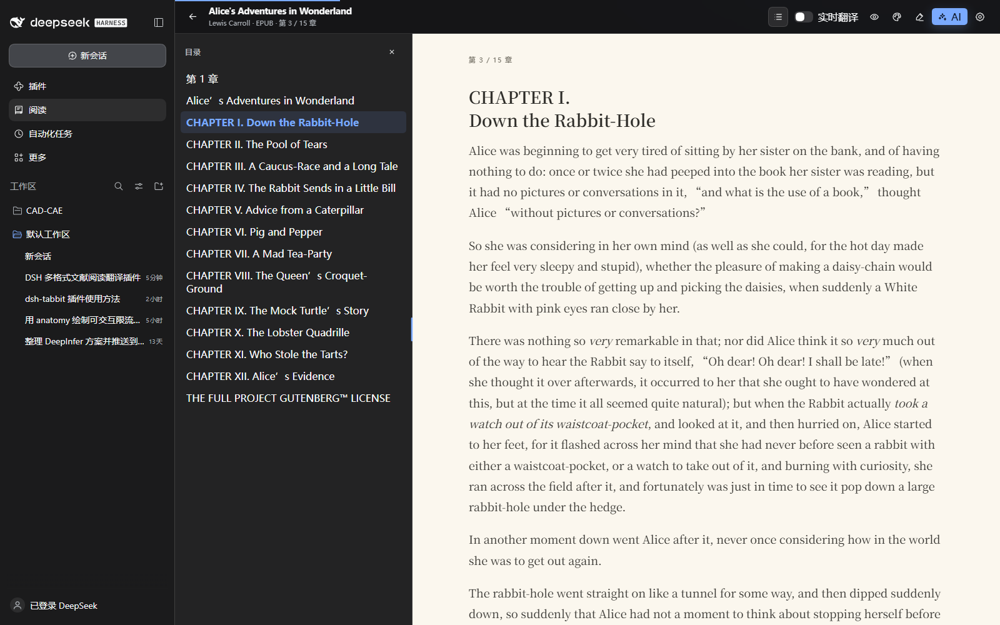

### 沉浸模式与翻页阅读

顶部任务栏里直接切换「滚动 / 横版」，横版旁边就是动画选择器。滚动模式支持 `↑ ↓ ← →` 按整屏平滑上下滚动；横版翻页支持：

- 鼠标滚轮翻页
- `↑ ↓ ← →`、`PageUp`、`PageDown`、空格
- 左右两侧半透明箭头
- 三种动画：横向滑页、书页覆盖、3D 书页
- 下一页与上一页的横向滑页方向相反（左出右进 / 右出左进）

横版翻页不再按屏幕高度硬切。它读取浏览器真实行盒，把页面断点落在完整行上；每页上下各有 48px / 56px 的纸张留白和遮罩，正文不会贴着窗口边缘，也不会露出半行字。若某一行跨越了底部边界，会**整行隐藏并归入下一页**，绝不会只显示上半行。每页行数根据当前视口、字号、行高和阅读宽度重新计算，并在末页过短时从上一页均衡几行，避免最后一页只剩几个字。改字体、行高、阅读宽度或译文出现后都会自动重排。

任意翻页模式到达章末后，单次翻页会停留在最后页并提示；**快速连按两次任意翻页键**（方向键、PageDown、空格、滚轮或按钮均可）才进入下一章，避免误触。

点顶部最大化按钮先在**当前 DSH 窗口内**进入沉浸：隐藏顶部工具栏、收起目录。需要全屏时，点右上角全屏按钮；全屏后仍保持沉浸，退出全屏也回到当前窗口的沉浸状态。左侧目录是一个半透明的纯图标按钮，它会读取当前背景（包括自定义壁纸的主要色块），自动选择深色或浅色图标和半透明底色，点击打开目录，目录内的 × 收起；右上角按钮或 `Esc` 退出沉浸。

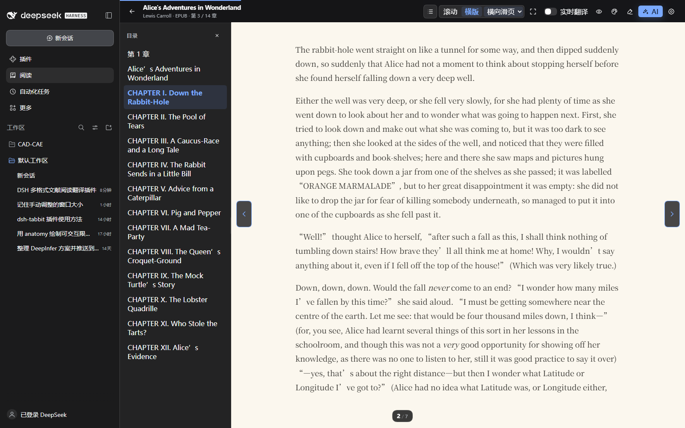

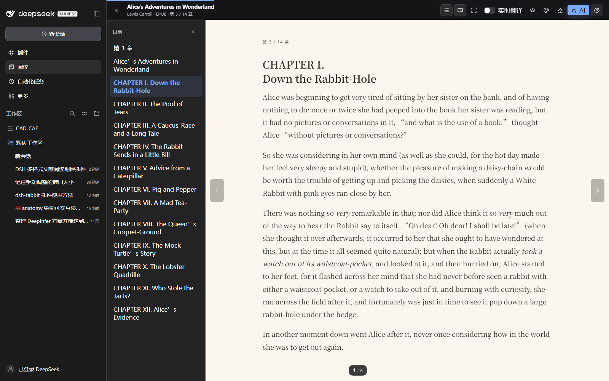

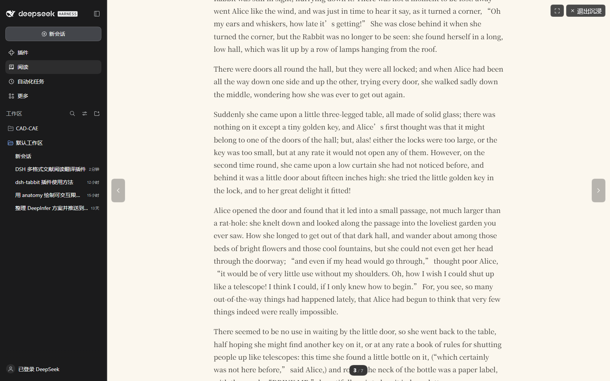

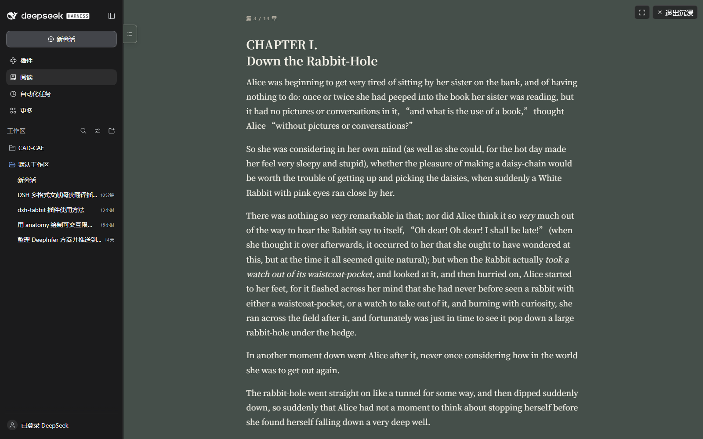

### 读得舒服：排版与护眼外观

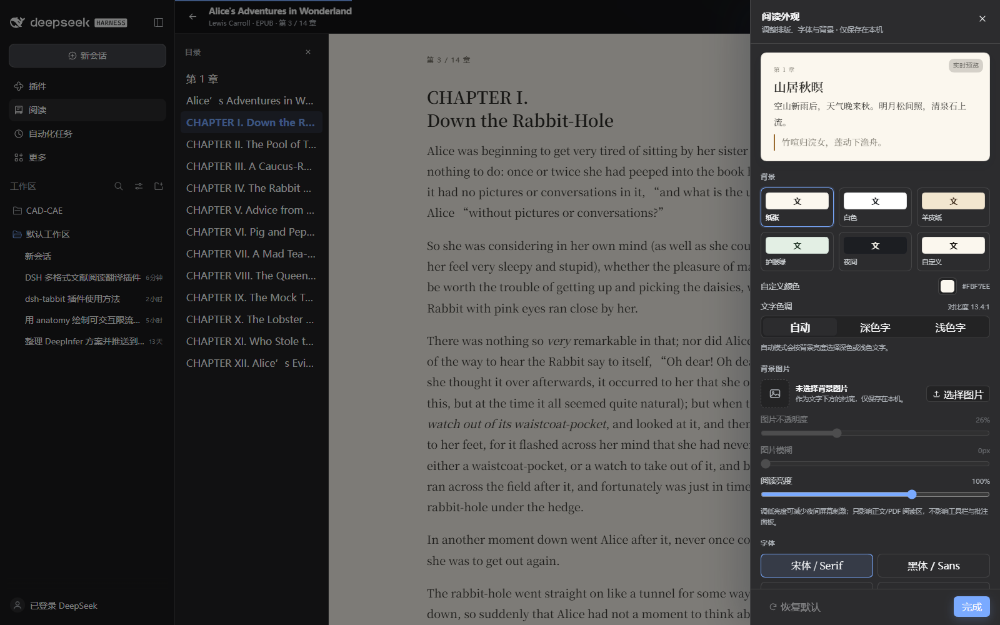

右侧外观面板可实时调整：宋体/黑体/楷体/系统字体、常规/中等/加粗、字号、行高、阅读宽度、**阅读区亮度**；纸张/白色/羊皮纸/护眼绿/夜间/自定义背景色；上传背景图片并调整透明度与模糊度。外观设置只影响文字版式，PDF 页面本身保持原样。

### 读外文：实时对照，随时回到原文

选中一段文字即可翻译、问 AI 或跳转 Google；实时翻译默认关闭，点顶部开关才发送翻译请求。开启后优先翻译当前阅读内容，PDF 在固定侧栏显示，流式格式在段落下方显示中文译文，点眼睛按钮可一键隐藏全部译文，只看原文。

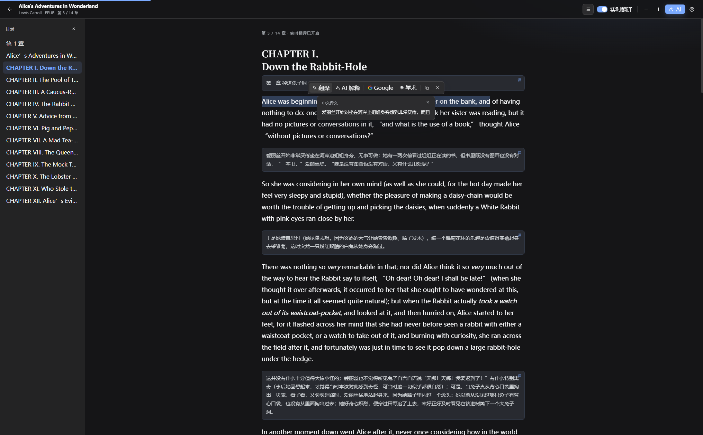

### 不懂就问：AI 阅读助手

AI 解释会结合选中的原文和上下文，给出含义、术语、语法和背景；可以继续追问，回答是流式的。

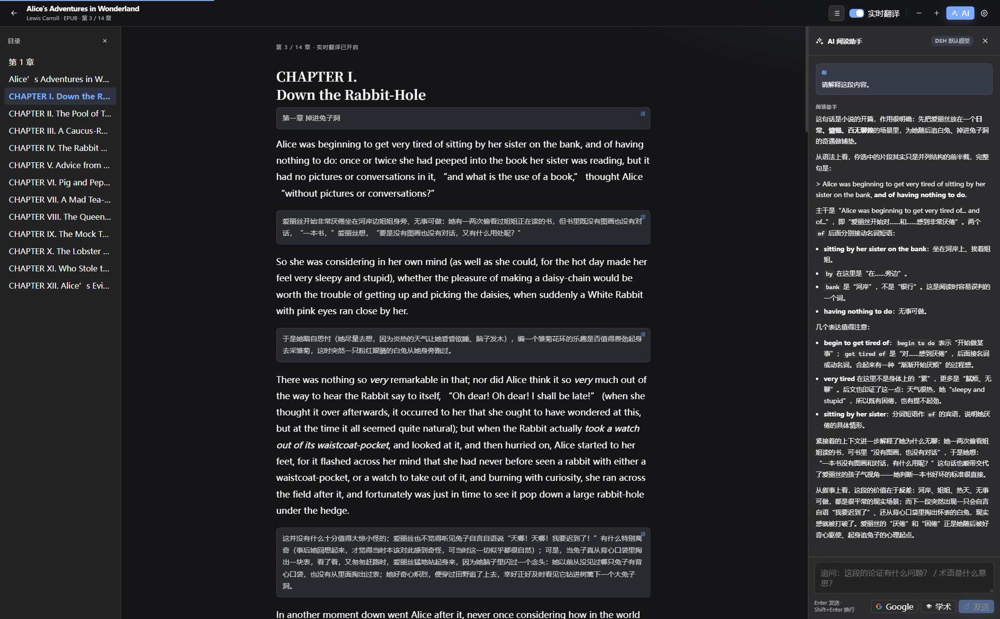

### 批注：荧光笔、下划线与便签

选中文字后点「标记」，可以选荧光笔（细/中/宽，黄/绿/粉/蓝）、下划线、便签，并写入备注。标注会以纸张质感的半透明色带、手绘下划线和便签图标呈现在原文上；右侧「批注」面板按章节/页分组回看、定位、编辑、删除。EPUB/MOBI/TXT 和 PDF 都支持。

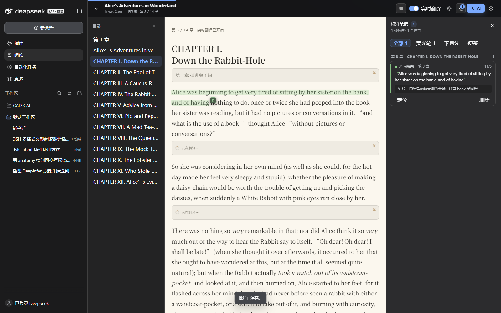

### PDF：连续页 / 横版单页 + 页级对照 + 批注

PDF.js 懒加载、连续页、可选中文字层；英文页面使用固定“中文对照”侧栏；选中 PDF 文字同样可以高亮、下划线、便签。

- 顶部「适宽」按钮点击后切换为「整页」：完整显示一页，不会超出屏幕。
- 切到横版翻页时，PDF 自动进入单页独占屏幕模式，按真实 PDF 页左右翻动，不再出现无法翻到下一页的问题。
- 解析与页面绘制使用独立 Worker；本地 Blob 通过 256 KiB 分段按需读取，正文与封面共享版本一致的引擎。阅读时取消封面任务。
- 横版保留当前页前后各 2 页；连续模式使用高度索引和两个间隔块，标准视口保留附近 7 页，缩小时按视口扩大窗口，不再创建千个占位节点。
- 当前页优先，附近页低分辨率预读；未缓存页面先显示预览再清晰化，缩放时保留旧图像。独立 ImageBitmap 缓存按估算 RGBA 字节限制为 48 MiB，回看时可复用已卸载页面的图像。
- 实际速度取决于页面复杂度、硬件及宿主环境。测试样本、原始指标及实际 DSH 教材检查记录见 `OPTIMIZATION.md` 第 12 节，不把简单大文件的结果外推到所有 PDF。
- 横版 PDF 同样使用左右按钮与顶部工具栏的上一页/下一页。

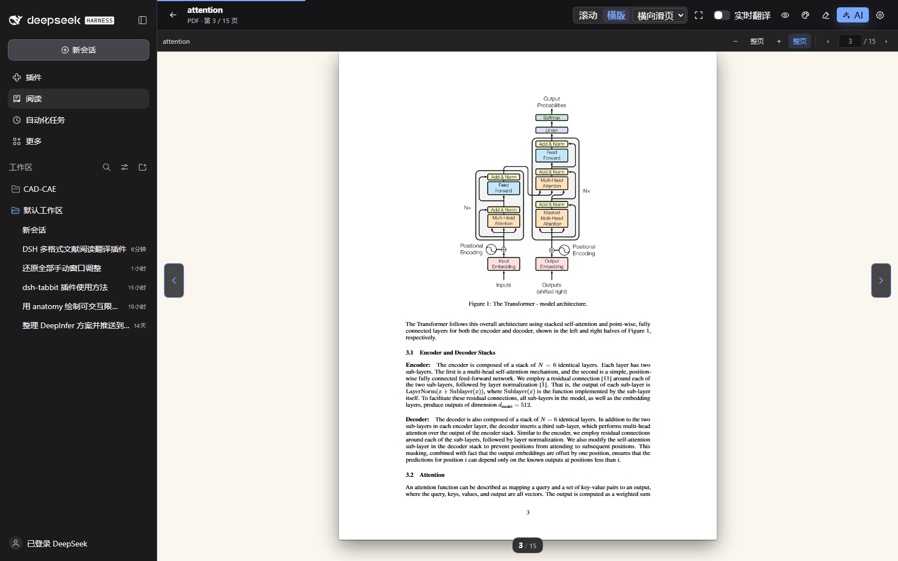

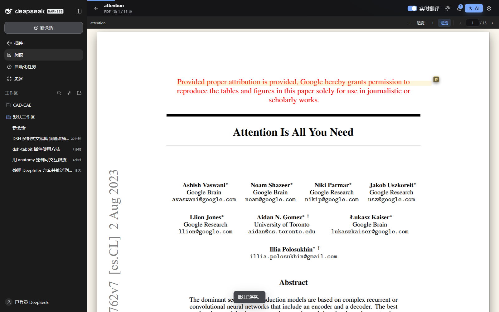

### 继续上次阅读

冷启动打开插件时，普通书籍会自动回到上次位置。对于体积大或页数多的 PDF，冷启动不会自动把整个文件读进侧栏，而是先绘制书架并显示「继续上次阅读」卡片；点一下卡片即可打开原位置，不会再出现打开插件就卡住几十秒的情况。

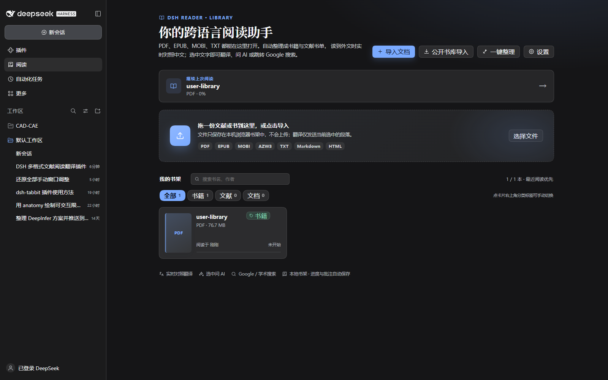

## 使用

1. 左侧栏点击 **阅读**。
2. 把 PDF / EPUB / MOBI / TXT 拖进书架，或点击「导入文档」；也可以点「公开书库导入」粘贴公开来源的文件直链。点「一键整理」自动分成书籍/文献/文档。
3. 打开文档。实时翻译默认关闭，需要时点顶部「实时翻译」开启。
4. 阅读时：
   - 顶部调色板按钮打开阅读外观：字体、字重、字号、行高、阅读宽度、目录宽度、亮度、背景与背景图片；目录右边缘也可以直接拖动；
   - 顶部任务栏直接切换滚动 / 横版，并选择横版动画；滚动支持 `←` / `→`，横版支持滚轮、方向键、空格和左右箭头；
   - 横版翻页按完整行分页，上下留白像纸质书，改字号/行高后自动重排，末页不会只剩零星文字；
   - 章末快速连按两次翻页键可直接进入下一章；
   - 顶部最大化按钮先在当前窗口进入沉浸模式；沉浸右上角可再切换全屏，左边缘半透明图标控制目录显示，图标颜色会随背景自动适配；
   - PDF 译文出现在侧栏，流式格式译文出现在段落下方；点顶部眼睛按钮可一键隐藏译文，只看原文；
   - 选中任意文字，出现「翻译 / 标记 / AI 解释 / Google / 学术」工具栏；
   - 「标记」中选荧光笔粗细/颜色、下划线或便签，并可以写备注；
   - 顶部荧光笔按钮打开批注面板，回看、定位、编辑、删除；
   - 右上角 **AI** 打开阅读助手，可继续追问；
   - 目录在正文左侧（EPUB/MOBI/TXT），PDF 用页面工具栏翻页；PDF 顶部「适宽 / 整页」可切换单页完整显示；
   - 切到横版时 PDF 自动单页独占屏幕，左右翻页；
   - 阅读进度、批注和外观设置自动保存；切换窗口或重新打开插件后自动回到上次的书与位置，下次从原位置继续。

## 权限与隐私

- **文件和笔记不上传**：文档、批注、阅读进度和背景图片保存在浏览器 IndexedDB / localStorage，仅本机可见。
- **公开书库导入走本机 Host 白名单**：只允许古登堡、Standard Ebooks、arXiv、Open Library、Internet Archive 等公开来源，拒绝内网地址、非 https 链接和超过 120 MB 的文件；不包含 Z-Library 等盗版书源。
- **翻译只发当前段落**：自动翻译按当前阅读内容分批；PDF 优先当前页，可选择预译下一页，附带术语表与少量上下文；选中翻译会附带有限上下文；不会把整本书发给模型。
- **AI 路由同源保护**：`/dsh-reader/ai/*` 要求阅读器自定义请求头，并拒绝跨站请求；模型 provider/model 由 Host 的默认模型决定，插件不接触 API Key。
- **不执行文档脚本**：EPUB/HTML 内容经过白名单清洗，脚本、iframe、事件属性、`javascript:` 链接都会被移除。
- **模型调用会计费**：翻译与 AI 解释使用你的 DSH 账号默认模型，按 DSH 的计费方式计算。实时翻译默认关闭，可随时开启或一键隐藏译文。

## 支持的格式细节

- **PDF**：文字型 PDF 可选中、可翻译；扫描件没有文字层，只会显示页面图像（后续可用 AI 视觉模型扩展）。
- **EPUB**：EPUB 2/3，NCX 或 nav 目录，内联图片，基础排版。复杂固定版式（FXL）按流式阅读降级。
- **MOBI**：PalmDOC/MOBI/KF8；DRM 或 HUFF/CDIC 等不支持的情况会给出中文提示。
- **TXT**：UTF-8/UTF-16/GB18030 自动识别，按「第…章 / Chapter N」分章。
- **Markdown / HTML**：按章节/标题渲染，HTML 清洗后显示。

## 开发

```powershell
cd dsh-reader
npm install
npm run build       # client bundle + lazy PDF.js assets
npm test            # server + parser + PDF text tests
npm run test:pdf-browser # 本机 Chrome：80MB / 1029 页 PDF 浏览器回归
npm run test:flow-browser # EPUB/MOBI/TXT/Markdown/HTML 横版整章与重排回归
npm run test:translation-browser # PDF 侧栏翻译、缓存和请求竞态回归（模拟服务）
npm run test:pdf-performance # 扫描图、透明矢量、混合页尺寸和线程回收
npm run test:pdf-performance -- --hidpi # 2 倍像素密度的预览→清晰化
npm run test:pdf-performance -- "真实文件.pdf" # 不限页数的实际文档检查
```

浏览器检查默认使用自动生成的合成 PDF，覆盖打开、连续翻页、键盘、滚轮、跳页、缩放、文本层、模式切换与关闭重开。结果与截图写入 `output/playwright/`，使用隔离的浏览器配置，不连接现有 Chrome 会话。可设置 `CHROME_PATH` 指向 Chrome/Chromium 可执行文件；使用 `npm run test:pdf-browser -- "路径\大型文档.pdf"` 可替换样本（该回归流程要求至少 1029 页）。详细修复原因与验证边界见 `OPTIMIZATION.md` 第 9 节。

流式横版检查调用实际格式解析器与阅读组件，遍历五种格式的测试章节，并检查三种动画、快速连点、译文/图片/字体/宽度变化、恢复进度、批注定位和切章。报告为 `output/playwright/flow-regression.json`；分页机制与复现记录见 `OPTIMIZATION.md` 第 10 节。

PDF 翻译采用原文与固定译文侧栏对照：开启顶部「实时翻译」后，当前页优先，段落逐步显示；悬停双向高亮，点击「定位原文」回到出处。侧栏提供暂停/继续、逐段重试与重译、字号、显示原文、预译下一页，以及按文档保存的术语表。译文在本地 IndexedDB 缓存，键包含原文、文档、模型、术语表与提示词版本；删除书籍时一并删除对应缓存。窄窗口自动上下排列，译文滚动不会触发原文翻页。

本轮同时更新了 Host 翻译接口，首次使用新版本请完整重启 DSH。`test:translation-browser` 使用隔离的临时 Chrome 配置和本地模拟服务，不调用真实模型；覆盖实际书架→打开 PDF→开启翻译、段落关联、缓存升级/复用、暂停、切书、模型切换与划词竞态。报告在 `output/playwright/translation-regression.json`。实际译文质量取决于 DSH 当前默认模型；本实现不包含扫描件 OCR 或完整的保留排版译文 PDF 导出。

目录：

```
dsh-reader/
  lib/              DSH Host 插件：静态资源 + AI 路由
  web/src/          浏览器端阅读器（React + DSH slots）
  web/src/pdf/      PDF.js 连续阅读器（懒加载）
  web/src/formats/  EPUB/MOBI/TXT 解析
  web/src/appearance/ 阅读外观预设、面板与 CSS 变量
  web/src/annotations/ 批注模型、范围计算、覆盖层、编辑器与面板
  client/client.js  构建产物（DSH 浏览器模块）
  dist/reader-assets/ 构建产物（pdf.bundle.js、解析/绘制 worker、cMaps、字体）
```

技术要点：

- 客户端是 DSH client module：`window.__ModuleLoader__.load(...)`，注册 `sidebar.panellist` + `main` 两个 slot。
- PDF.js 只在第一次打开 PDF 时通过 `import('/dsh-reader-assets/pdf.bundle.js')` 加载，避免拖慢 DSH 启动。
- Host 路由使用 `ctx.webServer.register`；模型调用走 `ctx.llm.stream`，默认模型由 `ctx.agentDefaultModel.currentSelection()` 解析。
- 翻译采用严格的 JSON 协议（`{"translations":[{"id","zh"}]}`），保留段落 id，不合并/拆分；模型漏段时只补译缺失部分。
- 批注用文本偏移（flow）和页面归一化矩形（PDF）持久化：改字号、换字体、缩放后仍能回到原文位置；引用失效时会按选中文字重新定位。
- 外观通过 CSS 变量注入 `dshr-root`，背景图片存在 IndexedDB，不参与文档导出。
- 单元/集成测试覆盖 Host 路由、格式解析、全格式分页与异步导航、PDF 分段读取/缓存/布局/清晰化、段落翻译调度与缓存身份、外观预设、批注范围计算和公开来源白名单，共 185 项。

## 已知限制

- 扫描版 PDF 可显示；无文本层的页面不支持选字翻译，当前没有 OCR。DRM 电子书、需要登录的在线书源不支持。
- 实时翻译按视口触发，快速滚动时译文会稍晚出现；这是为了控制 token 消耗。
- 复杂的 EPUB 固定版式、竖排/漫画排版会按流式阅读降级。
- Google / Google 学术在你的网络环境不可达时无法打开；AI 解释不受影响。
- 自动翻译会产生模型费用；可在顶部或设置中关闭。
- 批注暂不支持导出为 Markdown/PDF，也不支持手写涂鸦和跨页合并的一条标注；PDF 多页选择会按当前页保存。
- 背景图片只保存在本机；换浏览器/清空站点数据后需要重新选择。

## License

MIT
