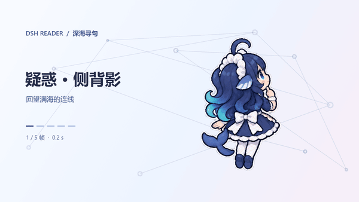

# DSH Reader pixel whale girl · 像素鲸鱼娘 · Pixel-Walmädchen

The library uses six poses for its categories and states. Click an image to open the original transparent PNG (1254 × 1254).

书库按分类和状态使用六款形象。点击图片查看 1254 × 1254 透明 PNG 原稿。

Die Bibliothek verwendet sechs Posen für ihre Kategorien und Zustände. Ein Klick öffnet das transparente PNG-Original (1254 × 1254).

**Character · 形象设定 · Charakter.** An innocent, lively and earnest girl who loves naps and plain white rice, gentle and without guile. She has three forms: the small pixel form shown here, a genki girl and a mature older sister. New art also follows the community character reference [DeepSeek Whale-chan](https://github.com/Neko3000/deepseek-whalechan). 天真可爱、活泼认真、单纯没什么心思、爱睡觉、喜欢吃白饭的温柔闺女，分小小（本图集）、元气、成熟三种形态；新图同时参照社区角色规范 DeepSeek Whale-chan。Ein unschuldiges, munteres und gewissenhaftes Mädchen, sanft und arglos, das gern schläft und am liebsten weißen Reis isst. Es gibt drei Formen: die kleine Pixelform hier, ein quirliges Mädchen und eine erwachsene große Schwester. Neue Bilder folgen zusätzlich der Community-Referenz DeepSeek Whale-chan.

| Illustration | 场景 | Where it appears | Einsatzort |
| --- | --- | --- | --- |
|  | 书架首页 | Library home | Bibliotheksstart |
|  | 书籍分类 | Books category | Bücher |
|  | 文献分类、搜索无结果 | Papers category and empty search results | Fachliteratur und erfolglose Suche |
|  | 文档分类 | Documents category | Dokumente |
|  | 加入书单成功 | Successful add to a collection | Erfolgreiches Hinzufügen zu einer Sammlung |
|  | 空自建书单 | Empty custom collection | Leere eigene Sammlung |

The original PNGs are for design and documentation. The plugin loads transparent 192 × 192 WebP copies from its bundled assets.

原稿用于设计和文档，插件加载随包提供的 192 × 192 透明 WebP。

Die Originale dienen der Gestaltung und Dokumentation. Das Plugin lädt transparente WebP-Dateien mit 192 × 192 Pixeln aus dem Installationspaket.

## Guide poses · 引导员动作 · Posen der Begleiterin

Four poses guide readers through the step-by-step screenshots on the project page. They were produced with an image generator from the waving and note-taking stickers above, and the green background was removed locally. All guide poses are transparent PNGs. Poses 07 and 08 are 1264 × 1264, and the revised poses 09 and 10 are 1254 × 1254. The plugin does not bundle them.

四款动作用在项目主页的分步引导截图里。它们以上面的挥手和记笔记贴纸为参考，由图像生成工具生成，再在本地去掉绿色背景。引导图均为透明 PNG。07、08 号为 1264 × 1264，重画后的 09、10 号为 1254 × 1254，不随插件安装。

Vier Posen begleiten die Schritt-für-Schritt-Bildschirmfotos auf der Projektseite. Sie wurden mit einem Bildgenerator aus den Stickern für Begrüßung und Notizen oben erzeugt, der grüne Hintergrund wurde lokal entfernt. Alle Posen sind transparente PNGs. 07 und 08 messen 1264 × 1264 Pixel, die überarbeiteten Posen 09 und 10 messen 1254 × 1254 Pixel. Das Plugin enthält sie nicht.

| Illustration | 场景 | Where it appears | Einsatzort |
| --- | --- | --- | --- |
|  | 每组引导的起始步和对话框步骤 | First step of each guide and dialog steps | Erster Schritt jeder Anleitung und Dialogschritte |
|  | 标注在左侧的步骤 | Steps whose callouts are on the left | Schritte mit Markierungen links |
|  | 标注在右侧的步骤，睁眼浅笑 | Steps with callouts on the right, eyes open with a small smile | Schritte mit Markierungen rechts, offene Augen und ein kleines Lächeln |
|  | 引导的最后一步，闭嘴微笑 | Last step of a guide, with a soft closed-mouth smile | Letzter Schritt einer Anleitung, mit einem sanften Lächeln |

## Character portraits · 角色立绘 · Charakterporträts

These full-body illustrations are 1024 × 1536 transparent PNGs for promotional artwork and dialogue previews.
全身立绘为 1024 × 1536 透明 PNG，供宣传图、对话预览和动画讲解页使用。
Die Ganzkörperporträts sind transparente PNGs mit 1024 × 1536 Pixeln für Werbemotive und Dialogvorschauen.

| Illustration | 场景 | Where it appears | Einsatzort |
| --- | --- | --- | --- |
|  | 成熟形态，讲解与宣传素材 | Mature form for narration and promotional art | Reife Form für Erklärungen und Werbemotive |
|  | 元气形态，开场与宣传素材 | Energetic form for openings and promotional art | Muntere Form für Einstiege und Werbemotive |
|  | 元气形态，动画讲解页开场：笔记写完，闭眼松一口气 | Energetic form, explainer opening: notes done, a relieved sigh | Muntere Form, Einstieg der Erklärseite: Notizen fertig, erleichtert |
|  | 元气形态，动画讲解页：发现出处没记，抬笔愣住 | Energetic form, explainer: the source is missing, pen raised in surprise | Muntere Form, Erklärseite: die Quelle fehlt, überrascht mit erhobenem Stift |
|  | 元气形态，动画讲解页：回想出处、认真听讲 | Energetic form, explainer: recalling the source and listening | Muntere Form, Erklärseite: erinnert sich an die Quelle und hört zu |
|  | 成熟形态，动画讲解页：演示操作时指向按钮 | Mature form, explainer: pointing at the button during a demo | Reife Form, Erklärseite: zeigt bei der Vorführung auf die Schaltfläche |

## Brand film actions

「深海寻句」开场动作素材。7 段各 1 秒、5 帧，另有第一视角定帧。编号链接打开 1264 × 1264 透明 PNG。[串看视频](brand-film/whale-actions-review.mp4) · [逐帧图](brand-film/contact-sheet.png)

Opening action assets for “Deep Sea Search”. Seven one-second clips at 5 fps and one first-person still. The numbered links open the 1264 × 1264 transparent PNG frames. [Preview video](brand-film/whale-actions-review.mp4) · [Frame sheet](brand-film/contact-sheet.png)

Bewegungsmaterial für den Einstieg in „Tiefseesuche“. Sieben einsekündige Clips mit je fünf Bildern und ein Standbild aus der Ich-Perspektive. Die nummerierten Links öffnen die transparenten PNG-Einzelbilder mit 1264 × 1264 Pixeln. [Vorschauvideo](brand-film/whale-actions-review.mp4) · [Einzelbildübersicht](brand-film/contact-sheet.png)

| Illustration | 场景 | Where it appears | Einsatzort |
| --- | --- | --- | --- |
|  [17](brand-film/17-a1-swim-1.png) · [18](brand-film/18-a1-swim-2.png) · [19](brand-film/19-a1-swim-3.png) · [20](brand-film/20-a1-swim-4.png) · [21](brand-film/21-a1-swim-5.png) | 潜水游动，入海跟拍 | Diving and swimming in the underwater tracking shot | Tauchen und Schwimmen in der Unterwasser-Kamerafahrt |
|  [22](brand-film/22-a2-puzzled-1.png) · [23](brand-film/23-a2-puzzled-2.png) · [24](brand-film/24-a2-puzzled-3.png) · [25](brand-film/25-a2-puzzled-4.png) · [26](brand-film/26-a2-puzzled-5.png) | 疑惑，停下观察珍珠 | Pausing to study the pearls | Hält inne und betrachtet die Perlen |
|  [27](brand-film/27-a3-catch-1.png) · [28](brand-film/28-a3-catch-2.png) · [29](brand-film/29-a3-catch-3.png) · [30](brand-film/30-a3-catch-4.png) · [31](brand-film/31-a3-catch-5.png) | 惊喜捞珍珠，伸手捧到胸前 | Catching the pearl and lifting it to her chest | Fängt die Perle und hebt sie an die Brust |
|  [32](brand-film/32-pov-hands-1.png) | 第一视角双手捧珍珠 | Holding the pearl in the first-person shot | Hält die Perle in der Ich-Perspektive |
|  [33](brand-film/33-a2-puzzled-rear-1.png) · [34](brand-film/34-a2-puzzled-rear-2.png) · [35](brand-film/35-a2-puzzled-rear-3.png) · [36](brand-film/36-a2-puzzled-rear-4.png) · [37](brand-film/37-a2-puzzled-rear-5.png) | 侧背疑惑，回望连线全景 | Puzzled rear three-quarter view of the pearl network | Blick auf das Perlennetz von schräg hinten |
|  [38](brand-film/38-a4-shake-1.png) · [39](brand-film/39-a4-shake-2.png) · [40](brand-film/40-a4-shake-3.png) · [41](brand-film/41-a4-shake-4.png) · [42](brand-film/42-a4-shake-5.png) | 甩头，问号散成光点 | Shaking her head as the question marks scatter | Schüttelt den Kopf, während die Fragezeichen zerfallen |
|  [43](brand-film/43-a5-swallow-1.png) · [44](brand-film/44-a5-swallow-2.png) · [45](brand-film/45-a5-swallow-3.png) · [46](brand-film/46-a5-swallow-4.png) · [47](brand-film/47-a5-swallow-5.png) | 吞下珍珠，腹部亮起 | Swallowing the pearl and glowing | Schluckt die Perle, der Bauch leuchtet |
|  [48](brand-film/48-a6-transform-1.png) · [49](brand-film/49-a6-transform-2.png) · [50](brand-film/50-a6-transform-3.png) · [51](brand-film/51-a6-transform-4.png) · [52](brand-film/52-a6-transform-5.png) | 变身元气鲸鱼娘，接动画讲解页 | Transforming into the genki form for the explainer opening | Verwandelt sich für den Beginn der Erklärseite in die muntere Form |
